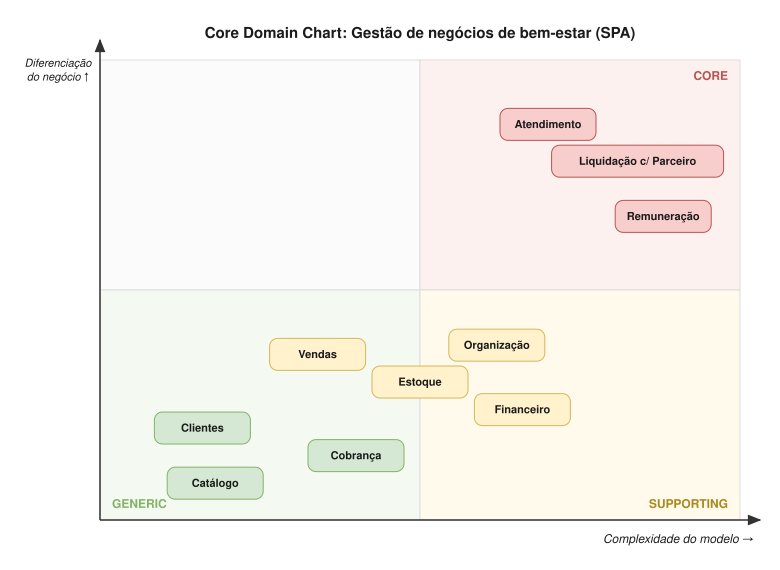
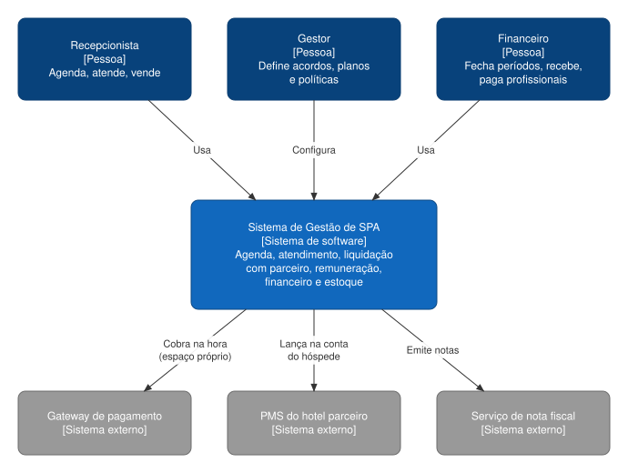

# Visão geral

## Domínio

**Gestão de negócios de bem-estar (SPA):** operar serviços prestados por profissionais, em espaço próprio ou dentro de estabelecimentos parceiros (como hotéis), controlando agenda, atendimento, remuneração, estoque e resultado financeiro de múltiplas unidades.

### Ponto de partida

- Existe um **cliente real**: um SPA que opera dentro de um hotel e recebe o repasse do hotel só no fim do mês, por isso precisa prever o lucro.
- O produto deve atender também **clientes futuros** com modelos mais comuns (espaço próprio, pagamento na hora).
- Estratégia: resolver o caso real com profundidade e modelar explicitamente as variações conhecidas ([ADR-001](adr/001-problema-real-com-variacoes-explicitas.md)).

## Subdomínios

Identificados por três critérios: **capacidades do negócio**, **quem se importa** e **eventos-pivô** do Event Storming.

| Subdomínio | Quem se importa | Classificação | Bounded context(s) |
|---|---|---|---|
| Operação de Atendimento (agendar, executar, cancelar, no-show) | Recepção | 🔴 **Core** | Atendimento |
| Parcerias Comerciais (acordos, participação, liquidação, previsão) | Dono / gestão comercial | 🔴 **Core** | Liquidação com Parceiro |
| Remuneração de Profissionais (planos, comissões, salário, bônus, metas) | Dono / RH | 🔴 **Core** | Remuneração |
| Estrutura Organizacional (empresa, unidades, profissionais) | Dono | 🟡 Supporting | Organização |
| Venda de Produtos | Recepção / profissionais | 🟡 Supporting | Vendas |
| Gestão de Estoque e Insumos | Gerente da unidade | 🟡 Supporting | Estoque |
| Gestão Financeira (caixa, carteiras, rateio, resultado) | Dono / financeiro | 🟡 Supporting | Financeiro |
| Catálogo (serviços, produtos, embalagens) | Gerente | 🟢 Generic | Catálogo |
| Relacionamento com Clientes (cadastro de recorrentes) | Recepção | 🟢 Generic | Clientes |
| Recebimentos (meios de pagamento, gateway, PMS) | Financeiro | 🟢 Generic | Cobrança |
| Fiscal, Identidade e Acesso | Contador / TI | 🟢 Generic | Soluções prontas |

**Critério de core:** diferenciação competitiva, não volume de uso nem quantidade de problemas ([ADR-015](adr/015-classificacao-dos-subdominios.md)).

**O que a classificação significa na prática**

- 🔴 **Core:** modelagem tática completa (agregados, invariantes, eventos, testes de domínio). O melhor esforço da equipe vai aqui.
- 🟡 **Supporting:** modelo enxuto, mas correto. Padrões conhecidos.
- 🟢 **Generic:** CRUD simples, biblioteca ou integração. Não construir o que se pode comprar.

## Core Domain Chart

Posição de cada contexto por **diferenciação do negócio** (vertical) e **complexidade do modelo** (horizontal).

## C4 — Nível 1: Contexto do sistema

| Elemento | Papel |
|---|---|
| Recepcionista | Agenda, conclui atendimentos, registra cancelamentos e no-shows, vende produtos |
| Gestor | Define acordos com parceiros, planos de remuneração, metas e políticas |
| Financeiro | Fecha períodos, registra recebimentos, paga profissionais |
| Gateway de pagamento | Recebimento na hora (espaço próprio) |
| PMS do hotel parceiro | Lançamento do serviço na conta do hóspede |
| Serviço de nota fiscal | Emissão de notas (subdomínio genérico) |

> O C4 nível 2 (containers) será desenhado quando a arquitetura de implantação for decidida (monólito modular ou serviços).
