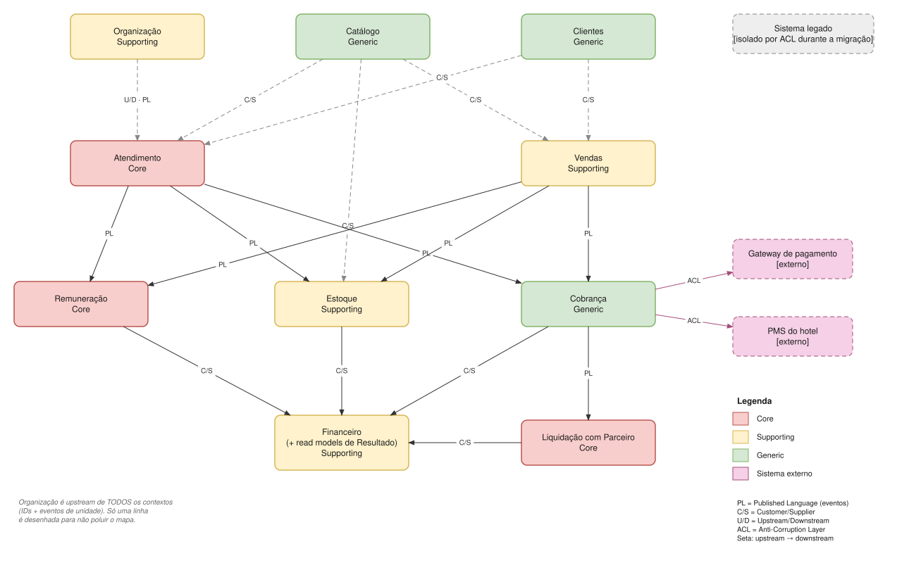

# Context Map

## Contextos

| # | Contexto | Classificação | Responsabilidade |
|---|---|---|---|
| 1 | [Organização](contextos/organizacao.md) | Supporting | Empresa, Unidade, cadastro do Profissional (identidade e vínculo) |
| 2 | [Atendimento](contextos/atendimento.md) | **Core** | Agenda, ciclo de vida do atendimento, salas, políticas de cancelamento e no-show |
| 3 | [Vendas](contextos/vendas.md) | Supporting | Venda de produtos, com profissional responsável opcional |
| 4 | [Cobrança](contextos/cobranca.md) | Generic | Recebimentos, inadimplência, integração com gateway e PMS |
| 5 | [Liquidação com Parceiro](contextos/liquidacao-parceiro.md) | **Core** | Acordos, faixas, liquidação do período, previsão |
| 6 | [Remuneração](contextos/remuneracao.md) | **Core** | Planos, comissões, salário, bônus, metas, folha do período |
| 7 | [Financeiro](contextos/financeiro.md) | Supporting | Caixa, Carteiras, lançamentos, rateio, read models de Resultado |
| 8 | [Estoque](contextos/estoque.md) | Supporting | Depósitos, itens, movimentações, ficha técnica, inventário |
| 9 | [Catálogo](contextos/catalogo.md) | Generic | Tipos de serviço, produtos, embalagens, preços de tabela |
| 10 | [Clientes](contextos/clientes.md) | Generic | Cadastro de clientes recorrentes |

## Relacionamentos

| Upstream → Downstream | Padrão | O que trafega |
|---|---|---|
| Organização → todos | U/D · Published Language | IDs e eventos `UnidadeCriada`, `UnidadeRenomeada`, `UnidadeDesativada`, `UnidadeReativada`. Os demais guardam só o ID e uma cópia local do nome |
| Catálogo → Atendimento, Vendas, Estoque | Customer/Supplier | Tipos de serviço, preço de tabela, produtos, unidade base e embalagens |
| Clientes → Atendimento, Vendas | Customer/Supplier | Dados do cliente recorrente |
| Atendimento → Cobrança, Remuneração, Estoque | Published Language | `AtendimentoConcluido`, `AtendimentoCancelado`, `NoShowRegistrado` (com consequências já calculadas) |
| Vendas → Cobrança, Remuneração, Estoque | Published Language | `VendaRealizada`, `VendaDevolvida` |
| Cobrança → Liquidação, Financeiro, Remuneração | Published Language | `ServicoCobrado`, `VendaCobrada`, `PagamentoRecebido`, `CobrancaInadimplente`, `CobrancaRecuperada`, `CobrancaEstornada` |
| Liquidação → Cobrança | Published Language | `AcordoFirmado`, `AcordoEncerrado` (define a modalidade de cobrança) |
| Liquidação, Remuneração, Estoque, Cobrança → Financeiro | Customer/Supplier | Lançamentos financeiros na carteira certa |
| Financeiro → Remuneração | Published Language | `CarteiraCriada`, `CarteiraRecomposta` (cópia local para metas de carteira) |
| Organização → Financeiro, Estoque | Published Language | `UnidadeCriada` gera a carteira própria e o depósito próprio da unidade |
| Cobrança → Gateway / PMS do hotel | **Anti-Corruption Layer** | Conceitos externos traduzidos antes de entrar no modelo |
| Sistema legado → contextos novos | **Anti-Corruption Layer** | Durante a migração (Strangler Fig) |

## Regras que mantêm o mapa gerenciável

1. **Cada contexto conhece só os eventos que consome e os lançamentos que produz.**
2. **Referência entre contextos é sempre por ID**, nunca por objeto.
3. **Regras moram no contexto que as usa** ([ADR-004](adr/004-sem-contexto-de-configuracao.md)); não existe contexto de "configurações".
4. **Eventos levam o resultado das regras**, não as regras ([ADR-007](adr/007-eventos-com-consequencias-calculadas.md)).
5. **O Financeiro não conhece regra de comissão nem faixa de hotel**: só recebe valores.
