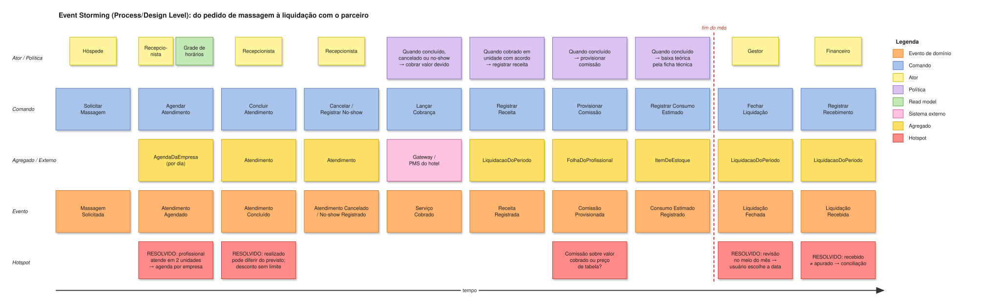

# Event Storming

## Fluxo principal: do pedido de massagem à liquidação com o parceiro

Leitura: cada coluna é um passo do processo, da esquerda para a direita. A linha tracejada vermelha marca o **fim do mês**, quando a liquidação com o parceiro é fechada e recebida.

## Legenda

| Cor | Elemento | Formato | Exemplo |
|---|---|---|---|
| 🟧 Laranja | Evento de domínio | Particípio, no passado | Atendimento Concluído |
| 🟦 Azul | Comando | Verbo no infinitivo | Concluir Atendimento |
| 🟨 Amarelo pequeno | Ator | Papel | Recepcionista |
| 🟪 Lilás | Política | "Quando X, então Y" | Quando concluído → provisionar comissão |
| 🟩 Verde | Read model | Informação para decidir | Grade de horários |
| 🩷 Rosa | Sistema externo | Nome do sistema | PMS do hotel |
| 🟨 Amarelo grande | Agregado | Substantivo | LiquidacaoDoPeriodo |
| 🟥 Vermelho | Hotspot | Pergunta ou conflito | Recebido ≠ apurado? |

## Como usar no workshop

1. Importe a biblioteca `diagramas/biblioteca/ddd-spa.xml` no draw.io (*Arquivo → Abrir biblioteca*).
2. **Big Picture:** cada participante escreve eventos em silêncio; depois o grupo ordena, remove duplicatas e marca hotspots.
3. Identifique os **eventos-pivô** (mudam a fase do processo): *Atendimento Agendado*, *Atendimento Concluído*, *Serviço Cobrado*, *Liquidação Fechada*.
4. **Design Level:** complete com comandos, atores, read models, políticas e agregados.

## Erros a evitar

- Telas como eventos ("Tela de checkout" não é evento).
- Eventos técnicos ("Registro inserido no banco").
- Descrever o que o código faz em vez de como o negócio funciona.
- Ignorar hotspots: eles costumam apontar exatamente os bugs do sistema atual.
