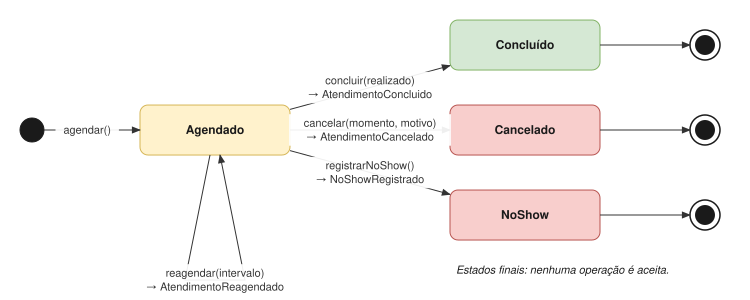
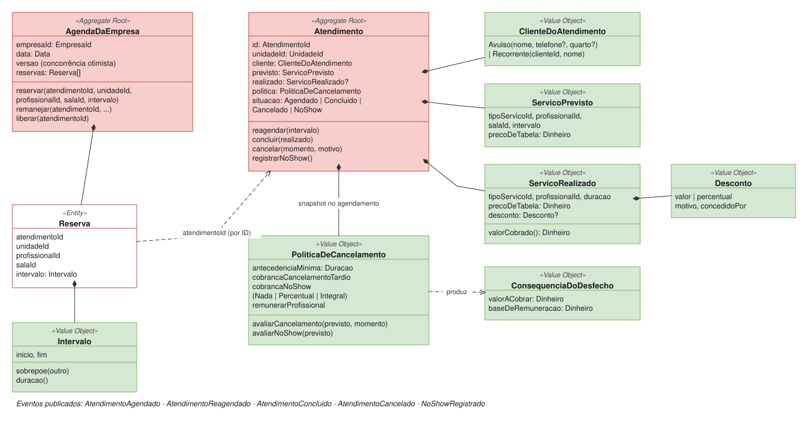

# Atendimento

| | |
|---|---|
| **Classificação** | 🔴 Core |
| **Subdomínio** | Operação de Atendimento |
| **Situação** | ✅ Modelagem tática definida (revista em 17/10/2026: itens, capacidade da sala, serviço sem profissional, quarto) |

## Propósito

Agendar atendimentos garantindo a disponibilidade de profissionais e salas, conduzir o ciclo de vida de cada atendimento e **publicar os desfechos com suas consequências já calculadas** para os demais contextos.

É a **fonte dos eventos** de todo o sistema. Agenda e Atendimento formam um único contexto com dois agregados principais ([ADR-005](../adr/005-agenda-e-atendimento-no-mesmo-contexto.md)).

Um atendimento é **uma visita do cliente**, que pode ter **mais de um serviço** ([ADR-035](../adr/035-atendimento-com-varios-servicos.md)): por exemplo, uma massagem e uma esfoliação, cada uma com o seu profissional e a sua sala. Cada serviço é um **item** do atendimento.

## Ciclo de vida



## Modelo



> O diagrama do modelo ainda mostra um serviço por atendimento e não mostra a capacidade da sala. O texto abaixo é a referência até o diagrama ser atualizado.

## 1. Comandos e eventos

| Comando | Ator | Evento |
|---|---|---|
| Agendar Atendimento | Recepcionista | AtendimentoAgendado |
| Reagendar Atendimento | Recepcionista | AtendimentoReagendado |
| Cancelar Atendimento | Recepcionista | AtendimentoCancelado |
| Registrar No-show | Recepcionista | NoShowRegistrado |
| Concluir Atendimento | Recepcionista | AtendimentoConcluido |
| Definir Política de Cancelamento | Gestor | PoliticaDeCancelamentoDefinida |
| Cadastrar Sala | Gestor | SalaCadastrada |
| Alterar Capacidade da Sala | Gestor | CapacidadeDaSalaAlterada |

## 2. Invariantes

**Na agenda**
- Um profissional não pode ter duas reservas com horários sobrepostos, **em nenhuma unidade da empresa**, nem em dois itens do mesmo atendimento.
- **Em nenhum momento a ocupação de uma sala passa da sua capacidade** ([ADR-036](../adr/036-capacidade-da-sala.md)). A ocupação é o maior número de reservas simultâneas no intervalo; uma reserva que só encosta no início ou no fim não conta.
- A reserva de um item **sem profissional ocupa só a sala** ([ADR-037](../adr/037-servico-sem-profissional.md)).
- Um atendimento reserva **todos os seus itens ou nenhum**.

**No atendimento**
- Todo atendimento tem **pelo menos um item**. O limite de itens por atendimento (hoje, 20) é da aplicação, não do domínio.
- Cada item usa um tipo de serviço com **oferta ativa na unidade** e uma **sala permitida** por essa oferta ([ADR-039](../adr/039-oferta-do-servico-por-unidade.md)).
- Um item tem profissional **se e somente se** a oferta do serviço exige profissional.
- Em unidade **com acordo com parceiro**, o **quarto é obrigatório**; em unidade de espaço próprio, é opcional ([ADR-041](../adr/041-quarto-obrigatorio-so-com-parceiro.md); veja a pendência C3).
- Só um atendimento **agendado** pode ser concluído, cancelado, reagendado ou marcado como no-show.
- Concluído, cancelado e no-show são **estados finais**.
- O atendimento guarda o **previsto** e o **realizado**, que podem ser diferentes (inclusive em quantidade de itens).
- A política de cancelamento aplicada é a **vigente no agendamento** ([ADR-008](../adr/008-snapshot-das-regras-no-momento-do-fato.md)).
- O **desconto é do atendimento** e é **rateado entre os itens**; a soma dos descontos rateados é igual ao desconto.
- O **valor cobrado nunca é negativo**, nem no total nem em cada item (o desconto não tem limite, mas não pode ultrapassar a soma dos preços).

## 3. Agregados

### AgendaDaEmpresa (por empresa e por dia)

Responde a uma única pergunta: *este profissional está livre e esta sala ainda tem lugar neste horário?* É por empresa porque um profissional pode atender em duas unidades no mesmo dia ([ADR-006](../adr/006-agenda-por-empresa-e-dia.md)).

```
AgendaDaEmpresa (Aggregate Root)
  empresaId: EmpresaId
  data: Data
  versao                                ← concorrência otimista
  reservas: Reserva[]

  reservar(atendimentoId, pedidos: PedidoDeReserva[])      todos ou nenhum
    para cada pedido:
      profissional informado e com horário sobreposto  → HorarioIndisponivel
      ocupação da sala no intervalo já igual à capacidade → SalaLotada
  remanejar(atendimentoId, itemId, novoIntervalo, novoProfissional?, novaSala?)
  liberar(atendimentoId)

PedidoDeReserva (Value Object)
  itemId, unidadeId, profissionalId?, sala: SalaDaAgenda, intervalo

SalaDaAgenda (Value Object)
  salaId, capacidade                    ← lida da Sala no momento da reserva

Reserva (Entity)
  atendimentoId, itemId, unidadeId, profissionalId?, salaId, intervalo
```

**Concorrência:** se duas recepcionistas salvarem ao mesmo tempo, o serviço de aplicação recarrega o agregado e tenta de novo. A recepcionista só vê erro se o horário realmente tiver sido ocupado.

### Sala

```
Sala (Aggregate Root)
  id: SalaId
  unidadeId: UnidadeId
  nome                                  ex.: "Sala 1", "Hidromassagem"
  capacidade: CapacidadeDaSala          quantos atendimentos ao mesmo tempo (≥ 1)
  ativa: bool

  alterarCapacidade(nova)               → CapacidadeDaSalaAlterada (redução com reservas futuras: A3)
```

O termo é genérico: o lugar pode ser uma maca, uma cadeira ou uma banheira. O modelo só conta quantos atendimentos cabem.

### Atendimento

```
Atendimento (Aggregate Root)
  id: AtendimentoId
  unidadeId: UnidadeId
  cliente: ClienteDoAtendimento
  quarto: Quarto?                       ← obrigatório em unidade com acordo com parceiro (ADR-041)
  previsto: ItemPrevisto[]              ← pelo menos um
  realizado: ItemRealizado[]?
  desconto: Desconto?                   ← do atendimento inteiro, rateado entre os itens
  politica: PoliticaDeCancelamento      ← snapshot do agendamento
  situacao: Agendado | Concluido | Cancelado | NoShow

  reagendar(itemId, intervalo)
  concluir(realizado, desconto?)   exige Agendado → AtendimentoConcluido
  cancelar(momento, motivo)        exige Agendado → AtendimentoCancelado(consequência por item)
  registrarNoShow()                exige Agendado → NoShowRegistrado(consequência por item)
  valorCobrado()                   soma dos itens realizados
```

Não existe `setSituacao`: cada mudança de estado é um método com nome de negócio.

**Agendar envolve os dois agregados.** O comando reserva os horários de todos os itens na `AgendaDaEmpresa` e cria um `Atendimento` novo na mesma transação. É uma exceção aceitável à regra de "um agregado por transação", porque criar um agregado novo não gera disputa. A conclusão com profissional, duração ou itens diferentes atualiza a agenda **depois**, via evento.

**Saber se a unidade tem parceiro.** Para exigir o quarto, o Atendimento mantém uma cópia local de quais unidades têm acordo com parceiro, atualizada por `AcordoFirmado` e `AcordoEncerrado` (como a Cobrança).

## 4. Value Objects

```
Intervalo                inicio, fim; sobrepoe(outro); duracao()

CapacidadeDaSala         inteiro ≥ 1

ItemPrevisto             itemId, tipoServicoId, profissionalId?, salaId, intervalo,
                         precoDeTabela (snapshot da oferta da unidade)

ItemRealizado            itemId, tipoServicoId, profissionalId?, duracao,
                         precoDeTabela, descontoRateado
                         valorCobrado() = precoDeTabela − descontoRateado (≥ 0)

Desconto                 valor | percentual, motivo, concedidoPor
                         ratear(itens): proporcional ao preço de tabela de cada item;
                         os centavos que sobram vão para o maior resto (empate: o item que vem antes)

ClienteDoAtendimento     Avulso(nome, telefone?)
                       | Recorrente(clienteId, nome)       ← nome copiado para o histórico

Quarto                   identificação do quarto no parceiro (ex.: "304")

PoliticaDeCancelamento   antecedenciaMinima
                         cobrancaNoCancelamentoTardio: Nada | Percentual(x) | Integral
                         cobrancaNoNoShow:             Nada | Percentual(x) | Integral
                         remunerarProfissional:        Nao | Sim | ProporcionalACobranca
                         avaliarCancelamento(previsto, momento): ConsequenciaDoDesfecho
                         avaliarNoShow(previsto): ConsequenciaDoDesfecho

ConsequenciaDoDesfecho   itens: (itemId, valorACobrar, baseDeRemuneracao)[]
                         valorACobrar() = soma dos itens
                         item sem profissional → baseDeRemuneracao = 0
```

Toda a lógica de "cobra ou não, remunera ou não" fica na `PoliticaDeCancelamento` e é testável isoladamente. O quarto saiu do `ClienteDoAtendimento` e foi para o atendimento, porque muda a cada hospedagem e vale também para o cliente recorrente.

## 5. Eventos publicados (contrato)

```
AtendimentoConcluido
  atendimentoId, unidadeId, cliente, quarto?, concluidoEm,
  itens: (itemId, tipoServicoId, profissionalId?, duracao,
          precoDeTabela, descontoRateado, valorCobrado)[]
  precoDeTabela, desconto, valorCobrado          ← totais

AtendimentoCancelado
  atendimentoId, unidadeId, canceladoEm,
  itens: (itemId, tipoServicoId, profissionalId?, valorACobrar, baseDeRemuneracao)[]
  valorACobrar                                   ← total

NoShowRegistrado
  atendimentoId, unidadeId, registradoEm,
  itens: (itemId, tipoServicoId, profissionalId?, valorACobrar, baseDeRemuneracao)[]
  valorACobrar                                   ← total
```

Os eventos carregam as **consequências já calculadas** ([ADR-007](../adr/007-eventos-com-consequencias-calculadas.md)), item por item ([ADR-035](../adr/035-atendimento-com-varios-servicos.md)).

| Consumidor | Reação |
|---|---|
| Cobrança | Uma cobrança pelo total: `valorCobrado` ou `valorACobrar` |
| Remuneração | Para cada item **com profissional**: comissão sobre `valorCobrado` ou `baseDeRemuneracao` do item. Itens sem profissional não geram remuneração |
| Estoque | Baixa teórica pela ficha técnica do `tipoServicoId` de cada item |
| Liquidação com Parceiro | Reage à **cobrança**, não ao atendimento |

**Consome**

| Evento | Origem | Reação |
|---|---|---|
| AcordoFirmado, AcordoEncerrado | Liquidação com Parceiro | Atualiza a cópia local de quais unidades têm parceiro (quarto obrigatório) |
| UnidadeDesativada | Organização | Bloqueia novos agendamentos na unidade |

## 6. Repositórios e serviços de aplicação

```
Repositórios
  AgendaDaEmpresaRepository     porEmpresaEData(empresaId, data)
  AtendimentoRepository         porId(id)
  SalaRepository                porId(id) · porUnidade(unidadeId)
  PoliticaRepository            vigente(unidadeId, data)

Serviços de aplicação
  AgendarAtendimento     ofertas da unidade (preço, salas, exige profissional) + política vigente
                         + capacidade das salas → reserva os itens → cria Atendimento
  ReagendarAtendimento
  CancelarAtendimento    cancela → libera horários
  RegistrarNoShow
  ConcluirAtendimento    verifica permissão para desconto (role) → conclui
  AlterarCapacidadeDaSala
```

Serviços de aplicação só orquestram. Permissões por role são verificadas aqui, **fora do domínio** ([ADR-014](../adr/014-desconto-explicito-permissoes-fora-do-dominio.md)).

## 7. Testes de domínio

**Agenda**
- Reservar profissional em horário sobreposto, **mesmo em outra unidade**, gera `HorarioIndisponivel`.
- Sala com capacidade 2: duas reservas sobrepostas são aceitas; a terceira gera `SalaLotada`.
- Sala com capacidade 1 se comporta como antes: a segunda reserva sobreposta gera erro; salas diferentes no mesmo horário são permitidas.
- Uma reserva que termina às 10h não ocupa a sala de uma reserva que começa às 10h.
- Hidromassagem com capacidade 4 e serviço sem profissional: quatro atendimentos simultâneos são aceitos, sem reservar nenhum profissional.
- Atendimento com dois itens em que o segundo está indisponível: nenhum dos dois é reservado.

**Atendimento**
- Dois itens de R$ 200 e R$ 100 com desconto de R$ 30: rateio de R$ 20 e R$ 10; valor cobrado de **R$ 270**.
- Três itens de R$ 100 com desconto de R$ 10: rateio de **R$ 3,34**, R$ 3,33 e R$ 3,33 (o centavo que sobra vai para o primeiro item).
- Item com profissional numa oferta que não exige profissional gera erro; item sem profissional numa oferta que exige gera erro.
- Agendar sem quarto numa unidade com acordo com parceiro gera erro; no espaço próprio, é aceito.
- Concluir um atendimento cancelado gera erro.
- Desconto maior que a soma dos preços de tabela gera erro (valor cobrado negativo).
- Cancelamento dentro da antecedência mínima não gera cobrança.
- Cancelamento tardio com `Percentual(50%)` de um atendimento com itens de R$ 200 e R$ 100 gera `valorACobrar` de **R$ 150** (R$ 100 + R$ 50).
- No-show com remuneração do profissional: o item sem profissional tem `baseDeRemuneracao` zero.
- Mudar a política depois do agendamento não afeta o atendimento já agendado.

## Pendências

Veja [Pendências](../05-pendencias.md): premissas A2 e A3, e o conflito C3 (quarto obrigatório × cliente de fora).
