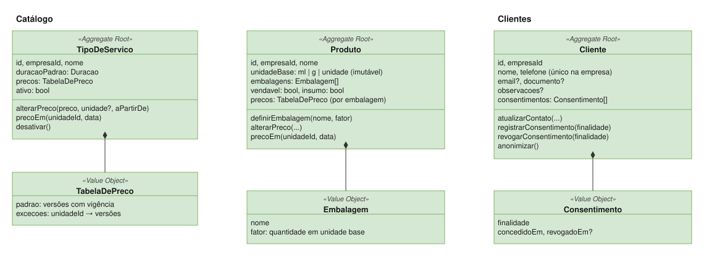

# Clientes

| | |
|---|---|
| **Classificação** | 🟢 Generic |
| **Subdomínio** | Relacionamento com Clientes |
| **Situação** | ✅ Modelagem definida (com premissa a confirmar: CL1) |

## Propósito

Manter o cadastro de **clientes recorrentes**, usado por Atendimento, Vendas e Cobrança. Atendimentos e vendas também aceitam **clientes avulsos** (nome, telefone, quarto), sem cadastro.

## Modelo



## Agregado

```
Cliente (Aggregate Root)
  id, empresaId
  nome
  telefone                       único dentro da empresa (evita duplicados)
  email?, documento?
  observacoes?                   preferências de atendimento
  consentimentos: Consentimento[]    finalidade, concedidoEm, revogadoEm?

  atualizarContato(...)
  registrarConsentimento(finalidade)
  revogarConsentimento(finalidade)
  anonimizar()                   atende a pedido de exclusão (LGPD) sem quebrar o histórico
```

## Regras

- **Promover um avulso a recorrente** cria um cliente novo com os dados informados; atendimentos e vendas antigos continuam como estavam ([ADR-008](../adr/008-snapshot-das-regras-no-momento-do-fato.md)).
- Os outros contextos guardam o `clienteId` e **uma cópia do nome**.
- Comunicações (lembrete de agendamento, promoções) exigem **consentimento** para a finalidade.
- Um pedido de exclusão **anonimiza** o cliente: nome e contatos são removidos, e os registros financeiros e de atendimento continuam válidos, sem identificá-lo.

## Atenção: dados de saúde (CL1)

SPAs costumam registrar **contraindicações** (gestação, alergias, problemas de circulação) antes de uma massagem. Pela LGPD, isso é **dado pessoal sensível**: exige consentimento específico, acesso restrito e cuidados extras.

Se o sistema for guardar essa **ficha de anamnese**, ela não deve ficar em `observacoes`. O ideal é um conceito próprio (`FichaDeAnamnese`), com acesso controlado e consentimento registrado, e talvez até um contexto próprio. O modelo atual **não guarda dados de saúde**.

## Eventos publicados

`ClienteCadastrado` · `ContatoAtualizado` · `ClienteAnonimizado`

Consumidores: Atendimento e Vendas (cópia do nome); `ClienteAnonimizado` faz todos os contextos removerem a cópia do nome.
