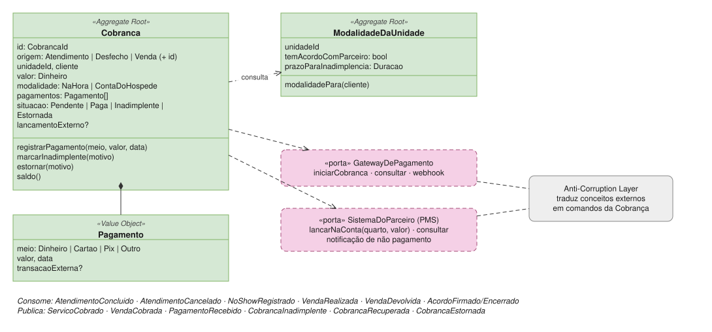
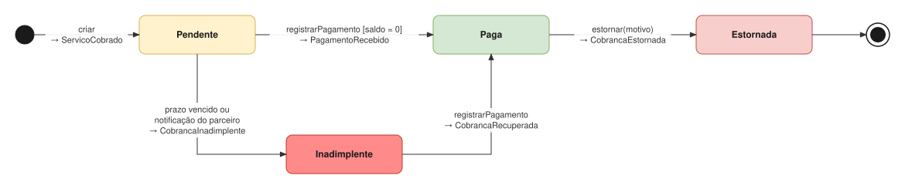

# Cobrança

| | |
|---|---|
| **Classificação** | 🟢 Generic |
| **Subdomínio** | Recebimentos |
| **Situação** | ✅ Modelagem tática definida (com premissas a confirmar: C1, C2) |

## Propósito

Cobrar o que é devido, saber se foi pago e isolar os sistemas externos (gateway de pagamento e sistema do hotel parceiro). Ela é generic porque meios de pagamento são um problema resolvido: o modelo só precisa **registrar** cobranças e pagamentos, e o processamento fica com serviços contratados.

A Cobrança recebe valores já calculados ([ADR-007](../adr/007-eventos-com-consequencias-calculadas.md)): não conhece política de cancelamento, desconto ou comissão.

## Modelo



## Ciclo de vida



## 1. Duas modalidades

| Modalidade | Quando | Como funciona |
|---|---|---|
| **NaHora** | Espaço próprio, ou cliente sem quarto numa unidade com parceiro | O cliente paga na recepção (dinheiro, cartão, Pix). Pode haver pagamento posterior dentro de um prazo |
| **ContaDoHospede** | Unidade com acordo com parceiro **e** cliente com quarto informado | O valor é lançado na conta do quarto pelo sistema do hotel (PMS). O hotel recebe do hóspede e repassa na liquidação |

A modalidade é decidida **por cobrança**, não só pela unidade: num SPA dentro de hotel, um cliente de fora (sem quarto) paga na hora ([ADR-031](../adr/031-modalidade-de-cobranca-por-cobranca.md)). Para isso, a Cobrança mantém uma cópia local de quais unidades têm acordo, atualizada pelos eventos da Liquidação.

## 2. Invariantes

- **Uma cobrança por origem** (atendimento, desfecho de cancelamento ou no-show, venda). Eventos repetidos não duplicam cobranças.
- Valor **zero não gera cobrança** (ex.: cancelamento sem multa).
- A soma dos pagamentos **nunca passa do valor**; a cobrança fica *Paga* quando a soma é igual ao valor.
- Uma cobrança `ContaDoHospede` **não recebe pagamentos na recepção**: quem recebe é o parceiro.
- Uma cobrança paga só é desfeita por **estorno**, com motivo.
- **A receita é reconhecida quando a cobrança é criada**, não quando é paga ([ADR-032](../adr/032-receita-reconhecida-na-cobranca.md)).

## 3. Agregados

```
Cobranca (Aggregate Root)
  id
  origem: Atendimento(id) | Desfecho(atendimentoId) | Venda(id)
  unidadeId, cliente
  valor: Dinheiro
  modalidade: NaHora | ContaDoHospede
  pagamentos: Pagamento[]                meio, valor, data, transacaoExterna?
  lancamentoExterno?                     referência no PMS do hotel
  situacao: Pendente | Paga | Inadimplente | Estornada

  registrarPagamento(meio, valor, data)  → PagamentoRecebido (+ CobrancaRecuperada se estava Inadimplente)
  marcarInadimplente(motivo)             → CobrancaInadimplente
  estornar(motivo, valor?)               total ou parcial → CobrancaEstornada
  saldo(): Dinheiro

ModalidadeDaUnidade (Aggregate Root)
  unidadeId
  temAcordoComParceiro: bool             cópia local (AcordoFirmado / AcordoEncerrado)
  prazoParaInadimplencia: Duracao        para cobranças NaHora não pagas (C2)

  modalidadePara(cliente): Modalidade
```

**Quando vira inadimplente**
- `NaHora`: quando o prazo configurado vence sem pagamento, ou quando alguém marca manualmente.
- `ContaDoHospede`: quando o sistema do hotel informa que o hóspede não pagou (pela ACL).

## 4. Anti-Corruption Layer

Os sistemas externos ficam atrás de **portas** (interfaces) definidas pela Cobrança, com um adaptador para cada fornecedor:

```
GatewayDePagamento (porta)
  iniciarCobranca(cobrancaId, valor, meio): ReferenciaExterna
  consultar(referencia): StatusExterno
  webhook → traduzido em registrarPagamento(...)

SistemaDoParceiro (porta)
  lancarNaConta(quarto, valor, descricao): ReferenciaExterna
  consultar(referencia): StatusExterno
  notificação de não pagamento → traduzida em marcarInadimplente(...)
```

Se o hotel não tiver integração, existe um **adaptador manual**: a recepcionista confirma o lançamento na conta do quarto, e a mesma interface é usada. Assim, o modelo funciona com ou sem integração.

## 5. Eventos

**Consome**

| Evento | Origem | Reação |
|---|---|---|
| AtendimentoConcluido | Atendimento | Cobrança de `valorCobrado` |
| AtendimentoCancelado, NoShowRegistrado | Atendimento | Cobrança de `valorACobrar`, se maior que zero |
| VendaRealizada | Vendas | Cobrança de `valorTotal` |
| VendaDevolvida | Vendas | Estorno parcial ou total |
| AcordoFirmado, AcordoEncerrado | Liquidação | Atualiza `ModalidadeDaUnidade` |

**Publica**

```
ServicoCobrado / VendaCobrada    cobrancaId, origem, unidadeId, modalidade, valor, data
PagamentoRecebido                cobrancaId, unidadeId, valor, meio, data
CobrancaInadimplente             cobrancaId, origem, unidadeId, valor
CobrancaRecuperada               cobrancaId, valor, data
CobrancaEstornada                cobrancaId, origem, unidadeId, valor
```

| Consumidor | Usa |
|---|---|
| Liquidação | `ServicoCobrado`/`VendaCobrada` com modalidade `ContaDoHospede`; inadimplência e estorno |
| Financeiro | Receita na criação; entrada de caixa no pagamento (só `NaHora`); perda na inadimplência; estorno da perda na recuperação |
| Remuneração | Retenção na inadimplência e liberação no pagamento ou na recuperação |

## 6. Repositórios e serviços de aplicação

```
Repositórios
  CobrancaRepository             porOrigem(origem) · pendentesVencidas(data)
  ModalidadeDaUnidadeRepository  porUnidade(unidadeId)

Serviços de aplicação
  CriarCobranca                  modalidade → cria → lança no PMS (se ContaDoHospede)
  RegistrarPagamento             pela recepção ou pelo webhook do gateway
  VerificarInadimplencia         rotina diária: pendentes com prazo vencido
  EstornarCobranca               verifica role → estorna
```

## 7. Testes de domínio

- Atendimento de R$ 180 no espaço próprio → cobrança `NaHora` de R$ 180.
- Atendimento num SPA de hotel com quarto 304 → `ContaDoHospede`; sem quarto → `NaHora`.
- No-show com `valorACobrar` zero → nenhuma cobrança.
- Pagamento de R$ 100 + R$ 80 numa cobrança de R$ 180 → *Paga*; um terceiro pagamento gera erro.
- Pagamento na recepção numa cobrança `ContaDoHospede` gera erro.
- Cobrança `NaHora` pendente com prazo vencido → *Inadimplente*; pagamento posterior → *Paga* com `CobrancaRecuperada`.
- O mesmo `AtendimentoConcluido` recebido duas vezes gera uma cobrança.
- Devolução de R$ 90 numa venda paga de R$ 180 → estorno parcial de R$ 90.

## Pendências

C1 e C2 em [Pendências](../05-pendencias.md).
