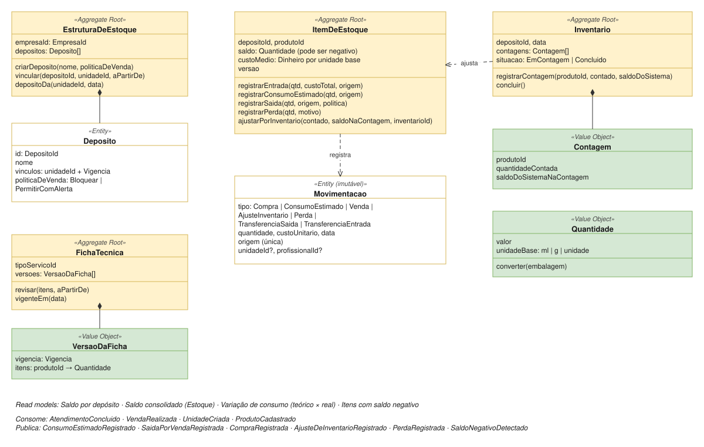

# Estoque

| | |
|---|---|
| **Classificação** | 🟡 Supporting |
| **Subdomínio** | Gestão de Estoque e Insumos |
| **Situação** | ✅ Modelagem tática definida (com premissas a confirmar: E1 a E4) |

## Propósito

Controlar os produtos usados como insumo nos atendimentos e os produtos vendidos, inclusive o **consumo fracionado e incerto** (cerca de 30 ml de óleo por massagem, de um frasco de 1 L), e informar ao Financeiro o **custo** de cada consumo, venda e perda.

## Modelo



## Ideias centrais

1. **Tudo é controlado na unidade base** (ml, g ou unidade). Embalagens existem só para converter compras e vendas: comprar 3 frascos de 1 L é uma entrada de 3.000 ml.
2. **O consumo do atendimento é estimado** pela ficha técnica e **nunca bloqueia** o atendimento. O saldo pode ficar negativo até o próximo inventário ([ADR-013](../adr/013-consumo-teorico-e-inventario.md)).
3. **O inventário corrige o estimado** e mostra a **variação** entre o consumo teórico e o real.
4. **O custo é o custo médio ponderado** do item, recalculado a cada compra ([ADR-028](../adr/028-custo-medio-ponderado.md)). O custo entra no resultado no consumo ou na venda, não na compra (premissa F2).

## 1. Comandos e eventos

| Comando | Ator | Evento |
|---|---|---|
| Criar Depósito | Gestor ou política: *quando unidade criada* | DepositoCriado |
| Vincular Unidade a Depósito | Gestor | UnidadeVinculadaAoDeposito |
| Definir / Revisar Ficha Técnica | Gestor | FichaTecnicaRevisada |
| Registrar Compra | Gerente | CompraRegistrada |
| Registrar Consumo Estimado | Política: *quando atendimento concluído* | ConsumoEstimadoRegistrado |
| Registrar Saída por Venda | Política: *quando venda realizada* | SaidaPorVendaRegistrada |
| Registrar Perda (quebra, vencimento) | Gerente | PerdaRegistrada |
| Transferir entre Depósitos | Gerente | TransferenciaRealizada |
| Iniciar / Registrar Contagem / Concluir Inventário | Gerente | InventarioConcluido |
| Ajustar por Inventário | Política: *quando inventário concluído* | AjusteDeInventarioRegistrado |
| (automático) | — | SaldoNegativoDetectado |

## 2. Invariantes

**Estrutura**
- **Uma unidade usa exatamente um depósito em cada data** (mesmo padrão das carteiras, [ADR-030](../adr/030-estrutura-de-estoque-espelha-a-financeira.md)).
- Um depósito pode atender **várias unidades** ou **nenhuma** (é o caso do estoque central, premissa E1).
- Toda unidade nova ganha automaticamente um **depósito próprio**.

**Ficha técnica**
- Quantidades maiores que zero, na unidade base do produto.
- Versões sem vigências sobrepostas. O consumo usa a **versão vigente na data do atendimento**, e o **tipo de serviço realizado** (não o previsto).

**Item de estoque**
- Toda alteração de saldo é uma **movimentação imutável**; correções são novas movimentações.
- **A mesma origem não gera duas movimentações** (idempotência).
- **Consumo estimado nunca é recusado**, mesmo deixando o saldo negativo.
- Na **venda**, a política do depósito decide: `Bloquear` recusa a saída sem saldo; `PermitirComAlerta` aceita e emite `SaldoNegativoDetectado` (premissa E3, [ADR-029](../adr/029-politica-de-venda-sem-saldo-por-deposito.md)).
- O **custo médio só muda em entradas** (compras e transferências recebidas). Saídas usam o custo médio do momento.

**Inventário**
- Cada produto é contado **uma vez** por inventário.
- O ajuste é a diferença entre o contado e o **saldo do sistema no momento da contagem**, para que movimentações durante a contagem não distorçam o resultado.
- Um inventário concluído não aceita novas contagens.

## 3. Agregados

### EstruturaDeEstoque (uma por empresa)

```
EstruturaDeEstoque (Aggregate Root)
  empresaId
  depositos: Deposito[]

  criarDeposito(nome, politicaDeVenda)
  vincular(depositoId, unidadeId, aPartirDe)       valida: unidade em um só depósito por data
  depositoDa(unidadeId, data): DepositoId

Deposito (Entity)
  id, nome
  vinculos: (unidadeId, vigencia)[]
  politicaDeVenda: Bloquear | PermitirComAlerta
```

Exemplo:

```
Depósito Central                (sem unidades: recebe as compras da matriz)
Depósito Zona Sul               Hotel X + Espaço Próprio
```

Depósito e carteira são **agrupamentos independentes** ([ADR-011](../adr/011-agrupamentos-financeiro-e-estoque.md)): duas unidades podem dividir o depósito sem dividir o resultado.

### FichaTecnica (uma por tipo de serviço)

```
FichaTecnica (Aggregate Root)
  tipoServicoId
  versoes: VersaoDaFicha[]

  revisar(itens, aPartirDe)
  vigenteEm(data): VersaoDaFicha

VersaoDaFicha (Value Object)
  vigencia
  itens: produtoId → Quantidade        ex.: Óleo de amêndoas 30 ml, Toalha descartável 2 un.
```

A ficha técnica fica no Estoque, e não no Catálogo, porque estimar consumo é uma regra de estoque ([ADR-027](../adr/027-ficha-tecnica-no-estoque.md)).

### ItemDeEstoque (um depósito + um produto)

```
ItemDeEstoque (Aggregate Root)
  depositoId, produtoId
  saldo: Quantidade                  pode ser negativo
  custoMedio: Dinheiro por unidade base
  versao                             concorrência otimista

  registrarEntrada(qtd, custoTotal, origem)          recalcula o custo médio
  registrarConsumoEstimado(qtd, origem)              nunca recusa
  registrarSaida(qtd, origem, politicaDeVenda)       pode recusar (Bloquear)
  registrarPerda(qtd, motivo)
  ajustarPorInventario(contado, saldoNaContagem, inventarioId)

Movimentacao (imutável)
  tipo: Compra | ConsumoEstimado | Venda | AjusteInventario | Perda
      | TransferenciaSaida | TransferenciaEntrada
  quantidade, custoUnitario, data
  origem (única)
  unidadeId?, profissionalId?         para análise de consumo
```

Um agregado por depósito e produto: dois atendimentos simultâneos que consomem produtos diferentes não disputam o mesmo registro. As movimentações ficam guardadas à parte, como o histórico do item.

```
Custo médio após uma entrada
  novoCusto = (saldo × custoMedio + custoTotalDaEntrada) / (saldo + quantidadeEntrada)
  se o saldo era negativo ou zero: novoCusto = custoTotalDaEntrada / quantidadeEntrada
```

### Inventario (um depósito + uma data)

```
Inventario (Aggregate Root)
  depositoId, data
  contagens: Contagem[]              produtoId, quantidadeContada, saldoDoSistemaNaContagem
  situacao: EmContagem | Concluido

  registrarContagem(produtoId, contado, saldoDoSistema)
  concluir()                         → InventarioConcluido
```

Ao concluir, uma política chama `ajustarPorInventario` em cada item contado.

### Transferência entre depósitos

Envolve dois itens (dois agregados). O serviço de aplicação registra a **saída** no depósito de origem com o custo médio dela; a **entrada** no destino acontece em seguida, por evento, com o mesmo custo e o mesmo `transferenciaId`. As duas operações são idempotentes.

Transferências **não têm efeito no resultado**: o custo só aparece quando o produto é consumido ou vendido.

## 4. Variação de consumo

O "certo controle" sobre o consumo incerto vem da comparação entre dois inventários:

```
consumoReal    = saldoInicial + entradas − saídasExatas − saldoContado
                 (saídas exatas: vendas, perdas, transferências enviadas)
consumoTeorico = soma dos consumos estimados no intervalo
variacao       = consumoReal − consumoTeorico
```

- **Por depósito e por produto:** o consumo real é medido.
- **Por profissional ou tipo de serviço:** só o consumo **teórico** é conhecido, porque ninguém mede quanto cada massagista usou. O read model mostra o teórico de cada uma; o real fica no nível do depósito.

> Correção em relação ao que tinha sido dito antes: a variação **teórico × real** não pode ser medida por profissional, apenas por depósito e produto.

## 5. Custos para o Financeiro

| Evento | Lançamento no Financeiro | Carteira |
|---|---|---|
| ConsumoEstimadoRegistrado | Custo de insumo = qtd × custo médio | Da unidade do atendimento |
| SaidaPorVendaRegistrada | Custo do produto vendido | Da unidade da venda |
| PerdaRegistrada | Despesa: perda de estoque | Ver E4 |
| AjusteDeInventarioRegistrado | Perda (falta) ou ajuste positivo (sobra) | Ver E4 |
| CompraRegistrada | Título a pagar ao fornecedor (sem lançamento de resultado) | Conta escolhida na compra (padrão: Caixa) |

## 6. Eventos

**Consome**

| Evento | Origem | Reação |
|---|---|---|
| AtendimentoConcluido | Atendimento | Consumo estimado de cada item da ficha técnica, no depósito da unidade |
| VendaRealizada | Vendas | Saída por venda, conforme a política do depósito |
| UnidadeCriada | Organização | Cria o depósito próprio da unidade |
| ProdutoCadastrado / EmbalagemDefinida | Catálogo | Atualiza a cópia local de unidade base e embalagens |

**Publica**

```
ConsumoEstimadoRegistrado      depositoId, unidadeId, profissionalId, produtoId, quantidade, custo
SaidaPorVendaRegistrada        depositoId, unidadeId, produtoId, quantidade, custo
CompraRegistrada               depositoId, fornecedor, produtoId, quantidade, valorTotal, conta
PerdaRegistrada                depositoId, produtoId, quantidade, custo, motivo
AjusteDeInventarioRegistrado   depositoId, produtoId, diferenca, custo
SaldoNegativoDetectado         depositoId, produtoId, saldo
```

## 7. Repositórios e serviços de aplicação

```
Repositórios
  EstruturaDeEstoqueRepository   porEmpresa(empresaId)
  FichaTecnicaRepository         porTipoServico(tipoServicoId)
  ItemDeEstoqueRepository        porDepositoEProduto(depositoId, produtoId)
  MovimentacaoRepository         porItem(intervalo) · porOrigem(origem)
  InventarioRepository           porDepositoEData(depositoId, data)

Serviços de aplicação
  RegistrarCompra                converte embalagens → entrada → CompraRegistrada
  RegistrarConsumoEstimado       depósito da unidade na data → ficha vigente → consumo por item
  RegistrarSaidaPorVenda         depósito da unidade → política → saída
  RegistrarPerda
  TransferirEntreDepositos       saída na origem → entrada no destino (por evento)
  IniciarInventario / RegistrarContagem / ConcluirInventario
  RevisarFichaTecnica
```

## 8. Testes de domínio

**Conversão e custo médio**
- Compra de 3 frascos de 1 L a R$ 80 → entrada de **3.000 ml**, custo médio de **R$ 0,08/ml**.
- Nova compra de 1 frasco a R$ 100 → saldo de 4.000 ml, custo médio de **R$ 0,085/ml** (R$ 340 / 4.000 ml).
- Entrada com saldo negativo usa só o custo da entrada.

**Consumo estimado**
- Massagem relaxante com ficha de 30 ml e custo médio de R$ 0,08 → saída de 30 ml e custo de **R$ 2,40**.
- Saldo de 20 ml e consumo de 30 ml → saldo de **−10 ml**, atendimento não é bloqueado, `SaldoNegativoDetectado` é emitido.
- Atendimento realizado com tipo diferente do agendado usa a ficha do tipo **realizado**.
- Ficha revisada no dia 15 → atendimentos até o dia 14 usam a versão anterior.
- O mesmo `AtendimentoConcluido` recebido duas vezes gera um consumo.

**Venda**
- Venda de 1 frasco (1.000 ml) com saldo de 500 ml e política `Bloquear` → erro.
- A mesma venda com `PermitirComAlerta` → saldo de −500 ml e alerta.

**Inventário e variação**
- Saldo do sistema de 2.100 ml, contado 1.950 ml → ajuste de **−150 ml** e perda de **R$ 12** (a R$ 0,08/ml).
- Movimentações depois da contagem não alteram o ajuste.
- Entre dois inventários: consumo teórico de 900 ml (30 atendimentos) e consumo real de 1.050 ml → variação de **+150 ml (16,7%)**.

**Estrutura e transferência**
- Vincular uma unidade a dois depósitos na mesma data gera erro.
- Transferência de 1.000 ml do Depósito Central para o Depósito Zona Sul → −1.000 ml num, +1.000 ml no outro, com o mesmo custo médio; o saldo consolidado não muda.

## Pendências

E1 a E4 em [Pendências](../05-pendencias.md).
