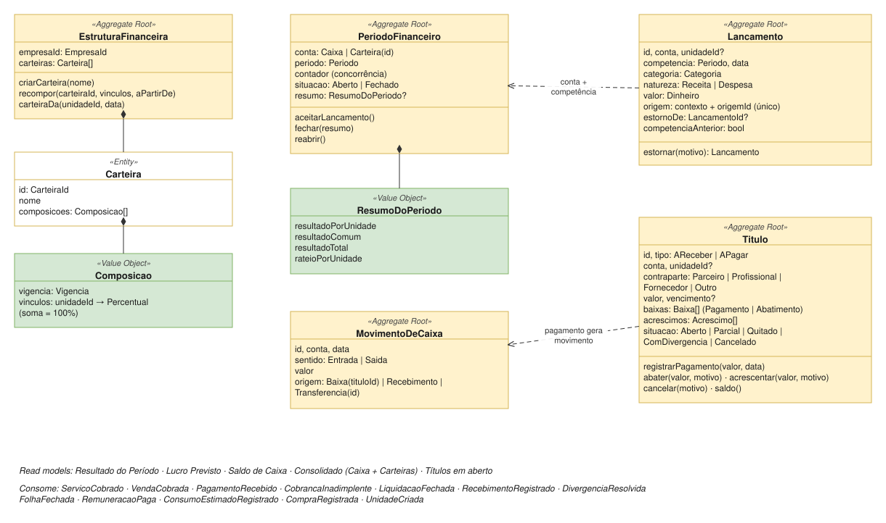
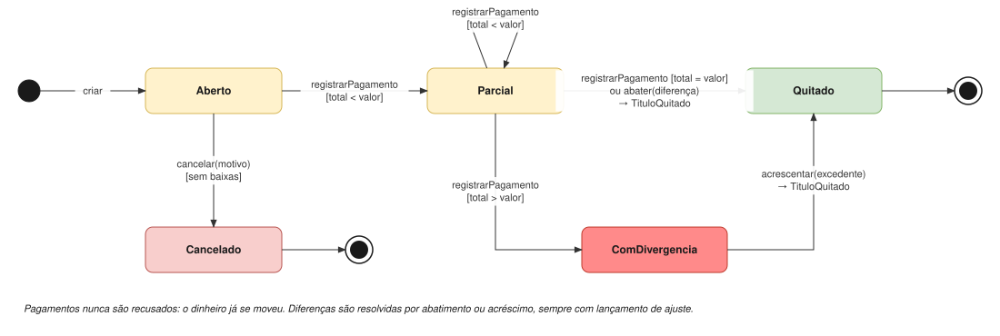

# Financeiro

| | |
|---|---|
| **Classificação** | 🟡 Supporting |
| **Subdomínio** | Gestão Financeira |
| **Situação** | ✅ Modelagem tática definida (com premissas a confirmar: F1, F2, F3) |

## Propósito

Registrar os fatos financeiros da empresa e responder a três perguntas:

1. **Quanto a unidade ou a carteira ganhou no mês?** (resultado, por competência)
2. **Quanto ainda vai ganhar ou gastar?** (lucro previsto e títulos em aberto)
3. **Quanto dinheiro entrou e saiu?** (caixa)

O Financeiro **não conhece regras** de comissão, faixas de hotel ou cancelamento. Ele recebe valores já calculados pelos outros contextos ([ADR-007](../adr/007-eventos-com-consequencias-calculadas.md)).

## Modelo



## Três registros diferentes

A separação mais importante deste contexto é entre **resultado** e **dinheiro** ([ADR-025](../adr/025-resultado-titulos-e-caixa-separados.md)).

| Registro | O que é | Exemplo |
|---|---|---|
| **Lançamento** | Receita ou despesa reconhecida num mês (competência) | Receita de R$ 200 do atendimento de 10/03 |
| **Título** | O que alguém deve à empresa, ou a empresa deve a alguém | O hotel deve R$ 27.500 da liquidação de março |
| **Movimento de caixa** | Dinheiro que efetivamente entrou ou saiu | Entrada de R$ 27.500 em 05/04, quando o hotel pagou |

Sem essa separação, o sistema confunde "março deu lucro" com "o dinheiro de março já entrou", que é exatamente a diferença que o cliente real vive todo mês.

## 1. Comandos e eventos

| Comando | Ator | Evento |
|---|---|---|
| Criar Carteira | Gestor ou política: *quando unidade criada* | CarteiraCriada |
| Recompor Carteira | Gestor | CarteiraRecomposta |
| Registrar Lançamento | Políticas (eventos dos outros contextos) ou gestor (despesas manuais) | LancamentoRegistrado |
| Estornar Lançamento | Role autorizada | LancamentoEstornado |
| Criar Título | Políticas ou gestor | TituloCriado |
| Registrar Pagamento | Financeiro ou política | BaixaRegistrada / TituloQuitado / TituloComDivergencia |
| Abater / Acrescentar | Role autorizada ou política (conciliação) | TituloQuitado |
| Cancelar Título | Role autorizada | TituloCancelado |
| Transferir entre Contas | Role autorizada | TransferenciaRealizada |
| Fechar Período | Gestor ou automático | PeriodoFinanceiroFechado |
| Reabrir Período | Role autorizada | PeriodoFinanceiroReaberto |

## 2. Invariantes

**Estrutura**
- **Uma unidade pertence a exatamente uma carteira em cada data.**
- Em cada composição, os percentuais das unidades **somam 100%**.
- As composições de uma carteira **não têm vigências sobrepostas**.
- Toda unidade nova ganha automaticamente uma **carteira própria** (100%), que o gestor pode reagrupar depois ([ADR-026](../adr/026-unidade-nova-ganha-carteira-propria.md)).

**Lançamentos**
- Lançamentos são **imutáveis**. Correção é feita com um **estorno** (lançamento oposto que referencia o original) e, se for o caso, um novo lançamento ([ADR-010](../adr/010-lancamentos-imutaveis.md)).
- Um lançamento só pode ser estornado **uma vez**, e um estorno não pode ser estornado.
- **A mesma origem não gera dois lançamentos** da mesma categoria (idempotência).
- Lançamentos de **unidade** vão para a carteira da unidade naquela data; **despesas comuns** vão direto para uma carteira, sem unidade; **despesas da empresa** vão para o Caixa.
- Só períodos **abertos** aceitam lançamentos. Um fato de um período fechado entra no **próximo período aberto**, como competência anterior (mesmo padrão do [ADR-021](../adr/021-fato-tardio-entra-na-proxima-folha.md)).

**Títulos e caixa**
- Existem dois tipos de baixa: **pagamento** (dinheiro que entrou ou saiu) e **abatimento** (diferença aceita, sem dinheiro). Todo pagamento gera **exatamente um movimento de caixa**; todo abatimento exige um **lançamento de ajuste**.
- Um pagamento **nunca é recusado**, porque o dinheiro já se moveu. Se os pagamentos passarem do valor, o título fica *ComDivergencia* até alguém aceitar o acréscimo.
- Um título só fica **Quitado** quando pagamentos + abatimentos = valor + acréscimos aceitos.
- Um título com baixas **não pode ser cancelado**.
- Uma transferência gera **dois movimentos** de mesmo valor (saída numa conta, entrada na outra), que se anulam no consolidado.

## 3. Agregados

### EstruturaFinanceira (uma por empresa)

Guarda as carteiras e sua composição. Fica num agregado só porque a regra "uma unidade em uma única carteira" envolve todas as carteiras ao mesmo tempo ([ADR-024](../adr/024-estrutura-financeira-num-agregado.md)). Muda raramente, então não há disputa.

```
EstruturaFinanceira (Aggregate Root)
  empresaId
  carteiras: Carteira[]

  criarCarteira(nome)
  recompor(carteiraId, vinculos, aPartirDe)     valida soma = 100% e unidade em uma só carteira
  carteiraDa(unidadeId, data): CarteiraId

Carteira (Entity)
  id, nome
  composicoes: Composicao[]

Composicao (Value Object)
  vigencia: Vigencia
  vinculos: unidadeId → Percentual
```

Exemplo:

```
Carteira "SPAs Zona Sul"
  composição desde 01/01/2026
    ├─ Unidade Hotel X       → 60%
    └─ Unidade Espaço Próprio → 40%
```

### PeriodoFinanceiro (uma conta + um mês)

Controla se o mês está aberto e, no fechamento, congela o resumo com o rateio.

```
PeriodoFinanceiro (Aggregate Root)
  conta: Caixa | Carteira(id)
  periodo: Periodo
  contador                       incrementado a cada lançamento (concorrência otimista)
  situacao: Aberto | Fechado
  resumo: ResumoDoPeriodo?

  aceitarLancamento()            exige Aberto; incrementa o contador
  fechar(resumo)                 → PeriodoFinanceiroFechado
  reabrir()                      role autorizada
```

O **contador** garante que nenhum lançamento entre depois do fechamento: registrar um lançamento e fechar o período alteram o mesmo registro pequeno, e um dos dois é refeito se houver conflito.

### Lancamento

```
Lancamento (Aggregate Root, imutável)
  id
  conta: Caixa | Carteira(id)
  unidadeId?                       vazio em despesas comuns e da empresa
  competencia: Periodo, data
  categoria: ReceitaServico | ReceitaProduto | ParticipacaoParceiro | Remuneracao
           | CustoInsumo | CustoProduto | PerdaPorInadimplencia | AjusteDeConciliacao
           | DespesaComum | DespesaDaEmpresa | Outros
  natureza: Receita | Despesa
  valor: Dinheiro                  sempre positivo; a natureza define o sinal
  origem: contexto + origemId
  estornoDe: LancamentoId?
  competenciaAnterior: bool

  estornar(motivo): Lancamento     cria o lançamento oposto
```

Cada lançamento é um agregado próprio: não há regra que envolva vários lançamentos ao mesmo tempo, e carregar o mês inteiro a cada gravação seria pesado.

### Titulo

```
Titulo (Aggregate Root)
  id, tipo: AReceber | APagar
  conta, unidadeId?
  contraparte: Parceiro | Profissional | Fornecedor | Outro
  valor, vencimento?
  origem: contexto + origemId
  baixas: Baixa[]                  tipo: Pagamento | Abatimento, valor, data
  acrescimos: Acrescimo[]          valor, motivo
  situacao: Aberto | Parcial | Quitado | ComDivergencia | Cancelado

  registrarPagamento(valor, data)  → BaixaRegistrada (+ TituloQuitado ou TituloComDivergencia)
  abater(valor, motivo)            diferença a menor aceita → TituloQuitado
  acrescentar(valor, motivo)       diferença a maior aceita → TituloQuitado
  cancelar(motivo)                 exige sem baixas
  saldo(): Dinheiro                pode ser negativo quando houve pagamento a mais
```



### MovimentoDeCaixa

```
MovimentoDeCaixa (Aggregate Root, imutável)
  id, conta, data
  sentido: Entrada | Saida
  valor
  origem: Baixa(tituloId) | RecebimentoDireto(origemId) | Transferencia(id)
```

`RecebimentoDireto` é o pagamento feito na hora no espaço próprio: a receita e a entrada acontecem juntas, sem título.

## 4. Como cada evento vira registro

| Evento | Lançamento (resultado) | Título | Caixa |
|---|---|---|---|
| ServicoCobrado / VendaCobrada | Receita de serviço / produto | — | — |
| PagamentoRecebido (espaço próprio) | — | — | Entrada (recebimento direto) |
| CobrancaInadimplente (espaço próprio) | Despesa: perda por inadimplência | — | — |
| CobrancaRecuperada | Estorno da perda por inadimplência | — | Entrada (via PagamentoRecebido) |
| CobrancaEstornada | Estorno da receita | — | Saída, se houve devolução de dinheiro |
| LiquidacaoFechada | Despesa: participação do parceiro | **A receber** do parceiro: receita − participação | — |
| RecebimentoRegistrado (cada pagamento do parceiro) | — | Pagamento no título | Entrada |
| DivergenciaResolvida, a menor | Ajuste de conciliação (despesa) | Abatimento do saldo | — |
| DivergenciaResolvida, a maior | Ajuste de conciliação (receita) | Acréscimo | — |
| FolhaFechada | Despesa: remuneração, **por unidade** | **A pagar** à profissional | — |
| RemuneracaoPaga | — | Baixa no título | Saída |
| ConsumoEstimadoRegistrado / SaidaPorVendaRegistrada | Custo de insumo / custo do produto vendido | — | — |
| PerdaRegistrada / AjusteDeInventarioRegistrado | Perda de estoque (ou ajuste positivo) | — | — |
| CompraRegistrada | — | **A pagar** ao fornecedor, na conta escolhida na compra | — |
| Despesa manual (aluguel, contador) | Despesa comum (carteira) ou da empresa (Caixa) | A pagar, se não paga na hora | Saída, se paga na hora |

Na unidade **dentro de parceiro**, quem recebe do hóspede é o hotel, por isso não há entrada de caixa por atendimento: o dinheiro entra quando o hotel paga a liquidação. Na unidade de **espaço próprio**, a entrada acontece a cada pagamento.

## 5. Read models

```
Resultado do Período (por unidade, por carteira, competência)
  = receitas − participação do parceiro − remuneração − custos − perdas ± ajustes
  carteira: + despesas comuns; rateio do total pelos percentuais da composição

Lucro Previsto (períodos abertos)
  = receitas lançadas
  − previsão da participação do parceiro       (Liquidação.previsao)
  − remuneração provisionada                   (RemuneracaoProvisionada)
  − custos lançados

Saldo de Caixa (por conta e consolidado)
  = soma das entradas − soma das saídas

Consolidado
  = Caixa + todas as carteiras (transferências se anulam)

Títulos em aberto
  a receber e a pagar, por vencimento e contraparte
```

O lucro previsto **nunca é gravado** ([ADR-012](../adr/012-lucro-previsto-como-read-model.md)): é recalculado a partir dos lançamentos e das previsões dos outros contextos.

## 6. Eventos publicados

```
CarteiraCriada / CarteiraRecomposta    carteiraId, vinculos, vigencia   → Remuneração (metas de carteira)
PeriodoFinanceiroFechado               conta, periodo, resumo
TituloQuitado                          tituloId, contraparte, valor
```

## 7. Repositórios e serviços de aplicação

```
Repositórios
  EstruturaFinanceiraRepository    porEmpresa(empresaId)
  PeriodoFinanceiroRepository      porContaEPeriodo(conta, periodo)
  LancamentoRepository             porOrigem(origem) · porContaEPeriodo(conta, periodo)
  TituloRepository                 porOrigem(origem) · emAberto(conta)
  MovimentoDeCaixaRepository       porConta(conta, intervalo)

Serviços de aplicação
  RegistrarLancamento     carteira da unidade na data → período aberto (ou próximo) → lançamento
  EstornarLancamento      verifica role → estorna
  CriarTitulo / RegistrarPagamento / Abater / Acrescentar / CancelarTitulo
  TransferirEntreContas   verifica role → dois movimentos com o mesmo transferenciaId
  FecharPeriodo           calcula o resumo e o rateio → fecha
  ReabrirPeriodo          verifica role → reabre
```

## 8. Testes de domínio

**Estrutura**
- Composição com 60% + 30% gera erro (soma ≠ 100%).
- Vincular uma unidade que já está noutra carteira na mesma data gera erro.
- Unidade criada recebe uma carteira própria com 100%.

**Lançamentos**
- Estornar um lançamento de R$ 200 cria um lançamento oposto de R$ 200; o resultado do período volta a zero.
- Estornar o mesmo lançamento duas vezes gera erro; estornar um estorno gera erro.
- O mesmo `ServicoCobrado` recebido duas vezes gera um lançamento.
- Lançamento para um período fechado entra no período seguinte, como competência anterior.

**Resultado e rateio** (carteira 60/40)
- Hotel X com resultado de R$ 10.000, Espaço Próprio com R$ 4.000 e despesa comum de R$ 2.000 → resultado da carteira de **R$ 12.000**, rateado em **R$ 7.200** e **R$ 4.800**.

**Liquidação com parceiro** (receita de R$ 40.000, participação de R$ 12.500)
- `LiquidacaoFechada` gera despesa de **R$ 12.500** e título a receber de **R$ 27.500**.
- Recebimento de R$ 27.500 quita o título e gera entrada de R$ 27.500.
- Recebimento de R$ 26.800 gera entrada de R$ 26.800 e deixa o título *Parcial*; a diferença de R$ 700 aceita gera abatimento, ajuste de conciliação (despesa) de **R$ 700** e quita o título.

**Títulos e caixa**
- Dois pagamentos de R$ 100 num título de R$ 200 levam a *Parcial* e depois a *Quitado*.
- Pagamento de R$ 300 num título de R$ 200 é aceito e leva a *ComDivergencia*; o acréscimo de R$ 100 aceito leva a *Quitado* com ajuste de receita de R$ 100.
- Abatimento sem motivo gera erro.
- Cancelar título com baixa gera erro.
- Transferência de R$ 1.000 do Caixa para uma carteira não altera o saldo consolidado.

**Lucro previsto** (mês aberto)
- Receitas de R$ 40.000, previsão de participação de R$ 12.500, remuneração provisionada de R$ 16.000 e insumos de R$ 1.000 → lucro previsto de **R$ 10.500**.

## Pendências

F1, F2 e F3 em [Pendências](../05-pendencias.md).
