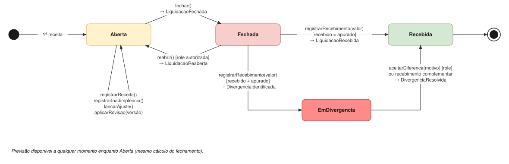
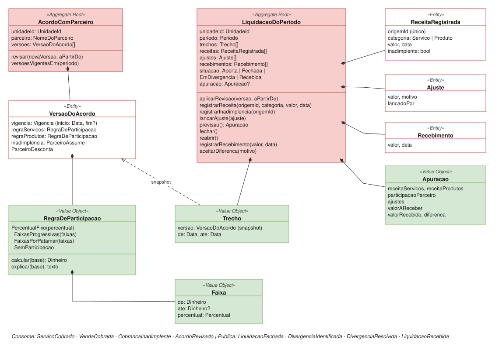

# Liquidação com Parceiro

| | |
|---|---|
| **Classificação** | 🔴 Core |
| **Subdomínio** | Parcerias Comerciais |
| **Situação** | ✅ Modelagem tática definida |

## Propósito

Apurar quanto o **estabelecimento parceiro deve à unidade** em cada período, aplicando as regras do acordo, oferecer a **previsão** desse valor durante o mês e **conciliar** o que o parceiro efetivamente pagou. É o problema real do cliente: o hotel recebe do hóspede e repassa ao SPA só no fim do mês, descontando a sua participação por faixas.

> Não confundir com **Remuneração** (o que a unidade paga ao profissional). Veja [ADR-009](../adr/009-dois-repasses-dois-contextos.md).

Unidades em **espaço próprio não têm acordo**: os eventos de cobrança delas são ignorados por este contexto.

## Ciclo de vida da liquidação



## Modelo



## 1. Comandos e eventos

| Comando | Ator | Evento |
|---|---|---|
| Firmar Acordo | Gestor | AcordoFirmado |
| Revisar Acordo (nova versão, com data de início escolhida) | Gestor | AcordoRevisado |
| Encerrar Acordo (a unidade deixa o parceiro) | Gestor | AcordoEncerrado |
| Aplicar Revisão | Política: *quando acordo revisado e houver liquidação aberta afetada* | RevisaoAplicada |
| Registrar Receita | Política: *quando serviço ou venda for cobrado* | ReceitaRegistrada |
| Registrar Inadimplência | Política: *quando a cobrança não for paga* | InadimplenciaRegistrada |
| Lançar Ajuste | Role autorizada | AjusteLancado |
| Fechar Liquidação | Gestor ou automático | LiquidacaoFechada |
| Reabrir Liquidação | Role autorizada | LiquidacaoReaberta |
| Registrar Recebimento | Financeiro | LiquidacaoRecebida ou DivergenciaIdentificada |
| Aceitar Diferença | Role autorizada | DivergenciaResolvida |

## 2. Invariantes

**No acordo**
- As versões do acordo de uma unidade **não têm vigências sobrepostas**. Ao revisar, a versão anterior termina no dia anterior ao início da nova.
- Uma revisão **não pode começar num período com liquidação fechada**. Para isso, a liquidação precisa ser reaberta antes.
- As faixas começam em zero, são contíguas e não se sobrepõem.
- Percentuais ficam entre 0% e 100%.

**Na liquidação**
- **Uma liquidação por unidade e por período.**
- Os **trechos cobrem o período inteiro, sem sobreposição**. Toda receita pertence a exatamente um trecho, pela data.
- Só liquidações **abertas** aceitam receitas, ajustes e revisões. Para lançar num mês fechado, a role autorizada precisa reabri-lo.
- **A mesma origem não é registrada duas vezes** (idempotência).
- Com "parceiro desconta", a inadimplência reduz a base. Com "parceiro assume", ela é ignorada.
- **Uma liquidação só termina Recebida quando a soma dos recebimentos é igual ao apurado** ou quando a diferença é aceita por uma role autorizada, com motivo.

## 3. Revisão do acordo (L1)

Quando revisa o acordo, **o usuário escolhe a partir de quando a nova versão vale**:

```
revisar(novaVersao, aPartirDe)
  aPartirDe = InicioDoProximoPeriodo        ← mês atual inteiro na versão antiga
            | Data(d)                       ← nova versão vale a partir do dia d
```

As duas opções resultam numa data de início explícita, que fica registrada na versão e aparece no extrato da liquidação: *"Acordo v2 vigente a partir de 15/03/2026"*.

Quando a revisão começa no meio de um período aberto, a liquidação passa a ter **dois trechos**, cada um com o snapshot da sua versão:

```
LiquidacaoDoPeriodo (Unidade SPA, 03/2026)
  ├─ Trecho 1: 01/03 a 14/03 → Acordo v1
  └─ Trecho 2: 15/03 a 31/03 → Acordo v2
```

**Como as faixas funcionam com dois trechos.** As faixas olham o **acumulado do mês inteiro**. A versão de cada trecho define só os percentuais aplicados às receitas daquele trecho. Assim, o limite de R$ 30.000 continua sendo mensal, como no contrato.

```
FaixasProgressivas, com trechos
  acumulado = 0
  para cada receita, em ordem de data:
    faixas = faixas da versão do trecho da receita
    distribui o valor nas faixas, a partir da posição "acumulado"
    acumulado += valor

FaixasPorPatamar, com trechos
  total = receita do mês inteiro
  para cada trecho:
    faixa = faixa da versão do trecho onde o total termina
    participação += receita do trecho × faixa.percentual
```

Com um trecho só (o caso mais comum), os dois cálculos são exatamente os de antes.

## 4. Conciliação do recebimento (L2)

```
registrarRecebimento(valor, data)
  exige Fechada ou EmDivergencia
  adiciona Recebimento
  se soma dos recebimentos = valorAReceber → Recebida            (LiquidacaoRecebida)
  senão                                    → EmDivergencia        (DivergenciaIdentificada(diferenca))

aceitarDiferenca(motivo)                    [role autorizada]
  exige EmDivergencia
  registra a diferença aceita, com motivo e responsável
  → Recebida                                (DivergenciaResolvida)
```

- A diferença pode ser para menos (o hotel pagou menos) ou para mais.
- Se o gestor decide **cobrar o hotel**, a liquidação permanece *EmDivergencia* até chegar um **recebimento complementar** que zere a diferença.
- A diferença aceita **não altera a apuração**: ela fica registrada separadamente, para o histórico mostrar o que o contrato previa e o que de fato foi pago.

## 5. Agregados

### AcordoComParceiro (um por unidade)

```
AcordoComParceiro (Aggregate Root)
  unidadeId: UnidadeId
  parceiro: NomeDoParceiro
  versoes: VersaoDoAcordo[]

  revisar(novaVersao, aPartirDe)        vigência sobreposta → erro
  versoesVigentesEm(periodo)            uma ou mais versões

VersaoDoAcordo (Entity)
  vigencia: Vigencia                    inicio: Data, fim: Data?
  regraServicos: RegraDeParticipacao
  regraProdutos: RegraDeParticipacao    SemParticipacao quando o parceiro não participa de produtos
  inadimplencia: ParceiroAssume | ParceiroDesconta
```

Exemplo:

```
AcordoComParceiro (Hotel X → Unidade SPA)
  v1, vigente de 01/01/2026 a 14/03/2026
    ├─ Serviços → FaixasProgressivas [até 30.000: 30% | acima: 35%]
    ├─ Produtos → PercentualFixo 10%
    └─ Inadimplência → Parceiro assume
  v2, vigente desde 15/03/2026
    ├─ Serviços → FaixasProgressivas [até 30.000: 25% | acima: 30%]
    ├─ Produtos → SemParticipacao
    └─ Inadimplência → Parceiro assume
```

A escolha de **incluir ou não os produtos** na participação do parceiro é feita pela `regraProdutos`. A faixa de cada categoria considera só a receita daquela categoria (base separada). A base combinada ficou fora do modelo por enquanto ([ADR-018](../adr/018-base-combinada-adiada.md)).

### LiquidacaoDoPeriodo (uma por unidade e por mês)

```
LiquidacaoDoPeriodo (Aggregate Root)
  unidadeId, periodo
  trechos: Trecho[]                     ← versão (snapshot) + intervalo de datas
  receitas: ReceitaRegistrada[]         ← origemId, categoria, valor, data, inadimplente
  ajustes: Ajuste[]                     ← valor, motivo, lancadoPor
  recebimentos: Recebimento[]           ← valor, data
  diferencaAceita: DiferencaAceita?     ← valor, motivo, aceitaPor
  situacao: Aberta | Fechada | EmDivergencia | Recebida
  apuracao: Apuracao?                   ← congelada no fechamento

  aplicarRevisao(versao, aPartirDe)     exige Aberta; divide o trecho afetado
  registrarReceita(origemId, categoria, valor, data)   exige Aberta; ignora origem repetida
  registrarInadimplencia(origemId)
  lancarAjuste(ajuste)                  exige Aberta
  previsao(): Apuracao
  fechar()                              exige Aberta → LiquidacaoFechada
  reabrir()                             exige Fechada
  registrarRecebimento(valor, data)     exige Fechada | EmDivergencia
  aceitarDiferenca(motivo)              exige EmDivergencia
```

`previsao()` e `fechar()` usam **o mesmo cálculo**; o fechamento só congela o resultado ([ADR-012](../adr/012-lucro-previsto-como-read-model.md)).

## 6. Value Objects

```
Periodo               ano, mes
Vigencia              inicio: Data, fim: Data?
Trecho                versao: VersaoDoAcordo, de: Data, ate: Data
Faixa                 de: Dinheiro, ate: Dinheiro?, percentual: Percentual
DiferencaAceita       valor, motivo, aceitaPor
Apuracao              receitaServicos, receitaProdutos, participacaoParceiro,
                      ajustes, valorAReceber, valorRecebido, diferenca

RegraDeParticipacao   (tipos fechados, mesma interface — ADR-002)
  = PercentualFixo(percentual)
  | FaixasProgressivas(faixas)
  | FaixasPorPatamar(faixas)
  | SemParticipacao

  calcular(base): Dinheiro
  explicar(base): texto
```

## 7. Eventos

**Consome**

| Evento | Origem | Reação |
|---|---|---|
| ServicoCobrado, VendaCobrada | Cobrança | `registrarReceita` |
| CobrancaInadimplente | Cobrança | `registrarInadimplencia` |
| CobrancaEstornada | Cobrança | Receita negativa no período aberto (devoluções e estornos) |
| AcordoRevisado | Este contexto | `aplicarRevisao` na liquidação aberta afetada |

**Publica**

```
LiquidacaoFechada          unidadeId, periodo, receitaBruta, participacaoParceiro, valorAReceber
RecebimentoRegistrado      unidadeId, periodo, valor, data                 ← a cada pagamento do parceiro
AcordoFirmado / AcordoEncerrado   unidadeId, data                       → Cobrança (modalidade)
DivergenciaIdentificada    unidadeId, periodo, valorAReceber, valorRecebido, diferenca
DivergenciaResolvida       unidadeId, periodo, diferencaAceita, motivo
LiquidacaoRecebida         unidadeId, periodo, valorRecebido
```

O **Financeiro** lança a participação e cria o título a receber no fechamento, registra a entrada de caixa a cada `RecebimentoRegistrado` e, quando houver diferença aceita, faz o abatimento ou acréscimo no título com um lançamento de ajuste. O read model de **Resultado** consulta `previsao()` e mostra as liquidações em divergência.

## 8. Repositórios e serviços de aplicação

```
Repositórios
  AcordoComParceiroRepository    porUnidade(unidadeId)
  LiquidacaoRepository           porUnidadeEPeriodo(unidadeId, periodo)

Serviços de aplicação
  FirmarAcordo
  RevisarAcordo          valida o aPartirDe escolhido pelo usuário → revisa
  RegistrarReceita       busca ou abre a liquidação do período → registra
  LancarAjuste           verifica role → lança
  FecharLiquidacao
  ReabrirLiquidacao      verifica role → reabre
  RegistrarRecebimento
  AceitarDiferenca       verifica role → aceita
  ConsultarPrevisao
```

## 9. Testes de domínio

**Cálculo**
- Faixas progressivas [até 30.000: 30% | acima: 35%], receita de R$ 40.000 → **R$ 12.500**.
- Faixas por patamar, mesma receita → **R$ 14.000**.
- Serviços R$ 25.000 + produtos R$ 8.000 → a faixa de serviços olha só os R$ 25.000 (30%).
- Produtos com `SemParticipacao` não geram participação do parceiro.

**Revisão no meio do mês** (v1: 30%/35%; v2 a partir do dia 15: 25%/30%; R$ 20.000 antes do dia 15 e R$ 20.000 depois)
- Progressivas: 20.000 × 30% + 10.000 × 25% + 10.000 × 30% = **R$ 11.500**.
- Por patamar: o total de 40.000 está na faixa de cima → 20.000 × 35% + 20.000 × 30% = **R$ 13.000**.
- Revisão com `InicioDoProximoPeriodo` mantém um único trecho no mês atual.
- Revisão com data num período fechado gera erro.

**Conciliação**
- Recebimento igual ao apurado leva a liquidação para *Recebida*.
- Recebimento menor gera *EmDivergencia* com a diferença correta.
- Recebimento complementar que zera a diferença leva a *Recebida*.
- `aceitarDiferenca` sem motivo gera erro.

**Gerais**
- Registrar receita numa liquidação fechada gera erro.
- O mesmo `origemId` registrado duas vezes conta uma vez.
- Com "parceiro assume", a inadimplência não altera o valor a receber.

## Pendências

Nenhuma. A premissa L4 (faixas olham o acumulado do mês inteiro quando há dois trechos) foi confirmada.
