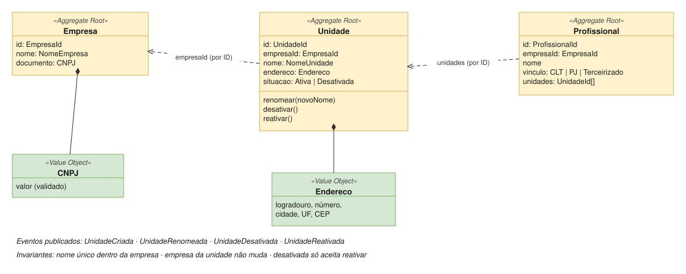

# Organização

| | |
|---|---|
| **Classificação** | 🟡 Supporting |
| **Subdomínio** | Estrutura Organizacional |
| **Situação** | ✅ Modelagem tática definida |

## Propósito

Manter a **identidade** da empresa, das unidades e dos profissionais. Nada além disso.

No sistema antigo, a `Unidade` era o modelo central de tudo e acumulava regras de outros contextos. Quando o negócio real mostrou que não era assim, surgiram as gambiarras. A decisão é **esvaziar a Unidade** ([ADR-003](../adr/003-unidade-esvaziada.md)).

## Para onde foi o que estava na Unidade

| Antes, na Unidade | Agora em | Como fica |
|---|---|---|
| Nome, endereço, situação | **Organização** | Permanece na Unidade |
| Modalidade (própria ou dentro de parceiro), percentuais do hotel | Liquidação com Parceiro | `AcordoComParceiro(unidadeId, versões)` |
| Carteira a que pertence, rateio | Financeiro | `Carteira.vinculos[unidadeId, %, vigência]` |
| Estoque que usa | Estoque | `Deposito.vinculos[unidadeId, vigência]` |
| Salas, horário de funcionamento | Atendimento | Recursos da agenda |
| Profissionais e comissões | Remuneração e Atendimento | `PlanoDeRemuneracao`, disponibilidade |
| Regras de cancelamento e no-show | Atendimento | `PoliticaDeCancelamento(unidadeId, vigência)` |

> Use esta tabela como checklist na refatoração: cada campo da classe `Unidade` atual que não estiver na primeira linha é candidato a sair.

## Modelo



### Comandos e eventos

| Comando | Evento |
|---|---|
| Criar Unidade | UnidadeCriada |
| Renomear Unidade | UnidadeRenomeada |
| Desativar Unidade | UnidadeDesativada |
| Reativar Unidade | UnidadeReativada |
| Cadastrar Profissional | ProfissionalCadastrado |

### Invariantes

- Toda unidade pertence a exatamente uma empresa, e isso não muda.
- O nome da unidade é único dentro da empresa (verificado por serviço de domínio antes de criar ou renomear).
- Uma unidade desativada não aceita alterações, só a reativação.

### Agregados

`Empresa` e `Unidade` são **agregados separados**: nenhuma invariante exige alterar os dois na mesma transação.

```
Empresa (Aggregate Root)
  id: EmpresaId
  nome: NomeEmpresa
  documento: CNPJ                    ← value object, se valida sozinho

Unidade (Aggregate Root)
  id: UnidadeId
  empresaId: EmpresaId               ← referência por ID
  nome: NomeUnidade
  endereco: Endereco                 ← value object
  situacao: Ativa | Desativada

  renomear(novoNome)   → UnidadeRenomeada
  desativar()          → UnidadeDesativada
  reativar()           → UnidadeReativada

Profissional (Aggregate Root)
  id: ProfissionalId
  empresaId: EmpresaId
  nome
  vinculo: CLT | PJ | Terceirizado
  unidades: UnidadeId[]
```

## Como os outros contextos usam a Unidade

- Guardam **só o `UnidadeId`**.
- Quando precisam do nome, mantêm uma **cópia local** atualizada por `UnidadeRenomeada`.
- Reagem a `UnidadeDesativada` conforme a própria regra: o Atendimento bloqueia novos agendamentos; Financeiro e Estoque mantêm o histórico.
