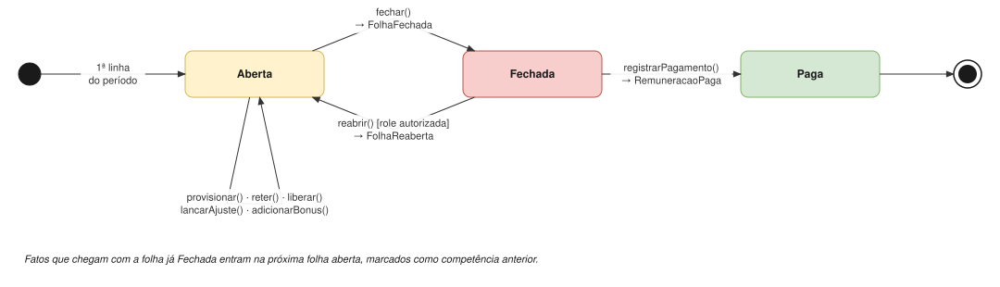
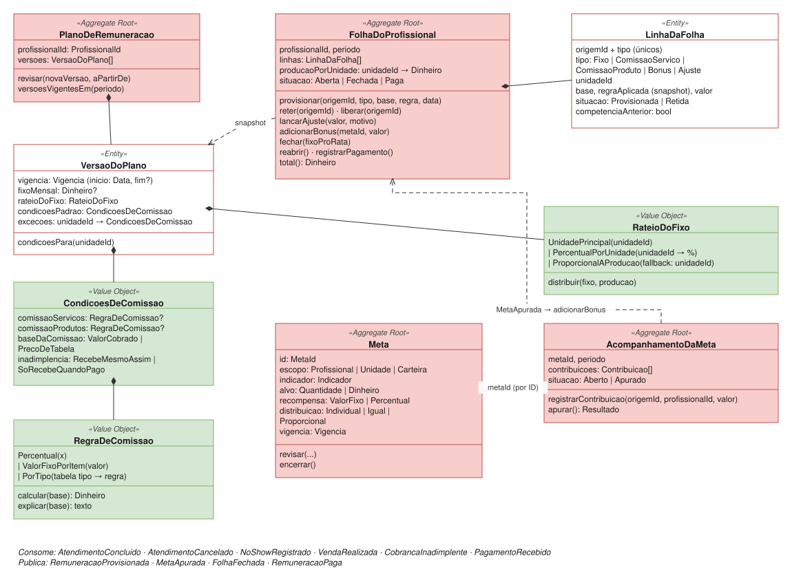

# Remuneração

| | |
|---|---|
| **Classificação** | 🔴 Core |
| **Subdomínio** | Remuneração de Profissionais |
| **Situação** | ✅ Modelagem tática definida (com premissas a confirmar: R2, R3) |

## Propósito

Calcular **o que a unidade deve a cada profissional**: valor fixo mensal, comissões sobre serviços e produtos, bônus por metas e ajustes, segundo o plano vigente no momento de cada fato, e consolidar tudo numa folha mensal. O cálculo é feito pelo próprio sistema.

> Não confundir com **Liquidação com Parceiro** (o que o parceiro deve à unidade). Veja [ADR-009](../adr/009-dois-repasses-dois-contextos.md).

## Ciclo de vida da folha



## Modelo



## 1. Comandos e eventos

| Comando | Ator | Evento |
|---|---|---|
| Definir Plano | Gestor | PlanoDefinido |
| Revisar Plano (data de início escolhida) | Gestor | PlanoRevisado |
| Definir Meta / Revisar Meta | Gestor | MetaDefinida / MetaRevisada |
| Provisionar Remuneração | Política: *quando atendimento concluído, cancelado ou no-show, ou venda realizada* | RemuneracaoProvisionada |
| Registrar Contribuição para Meta | Política: *quando atendimento concluído ou venda realizada* | ContribuicaoRegistrada |
| Reter Remuneração | Política: *quando cobrança inadimplente e o plano for "só recebe quando pago"* | RemuneracaoRetida |
| Liberar Remuneração | Política: *quando a cobrança retida for paga* | RemuneracaoLiberada |
| Lançar Ajuste | Role autorizada | AjusteLancado |
| Apurar Meta | Fechamento do período | MetaApurada |
| Fechar Folha | Gestor ou automático | FolhaFechada |
| Reabrir Folha | Role autorizada | FolhaReaberta |
| Registrar Pagamento | Financeiro | RemuneracaoPaga |

## 2. Invariantes

**No plano**
- As versões do plano de um profissional **não têm vigências sobrepostas**. Ao revisar, o usuário escolhe se a nova versão vale a partir do **próximo mês** ou de **uma data** (mesmo padrão do acordo com parceiro, [ADR-016](../adr/016-revisao-do-acordo-com-data-escolhida.md)).
- Uma revisão **não pode começar num período com folha fechada**, a menos que ela seja reaberta.
- Percentuais ficam entre 0% e 100%; valores não negativos.
- No rateio `PercentualPorUnidade`, os percentuais **somam 100%**.
- Toda versão tem **condições padrão**. As **exceções** valem para unidades específicas, e cada unidade aparece no máximo uma vez.

**Na folha**
- **Uma folha por profissional e por período.**
- **Cada fato gera no máximo uma linha de cada tipo** (`origemId + tipo` únicos), garantindo idempotência.
- Cada linha guarda a **regra aplicada** (snapshot da versão do plano vigente na data do fato, [ADR-008](../adr/008-snapshot-das-regras-no-momento-do-fato.md)).
- Só folhas **abertas** aceitam linhas. Um fato de um período já fechado entra na **próxima folha aberta**, marcado como *competência anterior*. Se a role autorizada preferir, ela reabre a folha original ([ADR-021](../adr/021-fato-tardio-entra-na-proxima-folha.md)).
- Linhas **retidas** não entram no total até serem liberadas.
- O **valor fixo mensal é proporcional aos dias** de cada versão do plano no mês.
- **Toda linha pertence a uma unidade.** As comissões usam as condições daquela unidade, e o Financeiro lança cada valor na carteira certa.
- O **fixo é dividido em uma linha por unidade**, segundo o rateio do plano; a soma das linhas é igual ao fixo proporcional do mês.

**Na meta**
- O alvo é maior que zero.
- Meta de escopo **Unidade** ou **Carteira** exige uma regra de **distribuição** do bônus.
- **As metas são apuradas antes do fechamento das folhas** do mesmo período.

## 3. Agregados

### PlanoDeRemuneracao (um por profissional)

```
PlanoDeRemuneracao (Aggregate Root)
  profissionalId: ProfissionalId
  versoes: VersaoDoPlano[]

  revisar(novaVersao, aPartirDe)          aPartirDe = InicioDoProximoPeriodo | Data(d)
  versoesVigentesEm(periodo)

VersaoDoPlano (Entity)
  vigencia: Vigencia                      inicio: Data, fim: Data?
  fixoMensal: Dinheiro?                   salário (CLT) ou valor fixo de contrato (PJ)
  rateioDoFixo: RateioDoFixo                        ← R6, escolhido pelo usuário
  condicoesPadrao: CondicoesDeComissao
  excecoes: unidadeId → CondicoesDeComissao         ← R5

  condicoesPara(unidadeId)                exceção da unidade, se houver; senão, o padrão

CondicoesDeComissao (Value Object)
  comissaoServicos: RegraDeComissao?
  comissaoProdutos: RegraDeComissao?
  baseDaComissao: ValorCobrado | PrecoDeTabela      ← R1, padrão: ValorCobrado
  inadimplencia: RecebeMesmoAssim | SoRecebeQuandoPago
```

Exemplo:

```
PlanoDeRemuneracao (Ana)
  v1, vigente desde 01/03/2026
    ├─ Fixo mensal: R$ 2.000 (lançado na unidade Hotel X)
    ├─ Condições padrão
    │    ├─ Serviços: Percentual 40% · Produtos: Percentual 10%
    │    ├─ Base: Valor cobrado
    │    └─ Inadimplência: Recebe mesmo assim
    └─ Exceção: Unidade Espaço Próprio
         ├─ Serviços: Percentual 50% · Produtos: Percentual 15%
         ├─ Base: Valor cobrado
         └─ Inadimplência: Só recebe quando pago
```

**Comissões por unidade (R5).** A mesma profissional pode ter condições diferentes em cada unidade onde atende. As condições padrão valem para qualquer unidade sem exceção cadastrada, então incluir a profissional numa unidade nova não exige mexer no plano. A unidade de cada linha vem do evento que a originou (`unidadeId` do atendimento ou da venda). Veja [ADR-022](../adr/022-condicoes-de-comissao-por-unidade.md).

**Fixo mensal com várias unidades (R6).** O fixo é um só por profissional, mas precisa ser lançado nas unidades (e, portanto, nas carteiras) onde ela atende. O usuário escolhe no plano como dividi-lo:

```
RateioDoFixo (Value Object)
  = UnidadePrincipal(unidadeId)                      tudo numa unidade
  | PercentualPorUnidade(unidadeId → %)              ex.: Hotel X 60%, Espaço Próprio 40%
  | ProporcionalAProducao(fallback: unidadeId)       na proporção do que ela produziu em cada unidade no mês

  distribuir(fixo, producaoPorUnidade): unidadeId → Dinheiro
```

- **Produção** é a soma do valor cobrado dos atendimentos concluídos e das vendas da profissional em cada unidade no mês. A folha acompanha esse valor (`producaoPorUnidade`) a partir dos mesmos eventos que geram as comissões.
- Se não houver produção no mês (férias, afastamento), o fixo vai para a unidade de **fallback**.
- Centavos que sobram na divisão vão para a unidade com a maior parte.

**Base da comissão (R1).** Seguindo o padrão de deixar o usuário decidir, a base virou um parâmetro das condições de comissão. Com `ValorCobrado`, o desconto concedido reduz a comissão; com `PrecoDeTabela`, o desconto sai só da margem da unidade. O evento `AtendimentoConcluido` já traz os dois valores. Em **cancelamento e no-show**, a base é sempre a `baseDeRemuneracao` calculada pela política de cancelamento ([ADR-007](../adr/007-eventos-com-consequencias-calculadas.md)).

**Inadimplência (R4).** A regra fica nas condições de comissão, e por isso pode variar por unidade. Com `SoRecebeQuandoPago`, a linha é **retida** quando chega `CobrancaInadimplente` e **liberada** quando chega o pagamento.

### Meta e AcompanhamentoDaMeta

A meta é a definição; o acompanhamento mede o resultado de um período. São agregados separados porque a definição muda raramente e o acompanhamento recebe contribuições o tempo todo ([ADR-020](../adr/020-metas-com-acompanhamento-separado.md)).

```
Meta (Aggregate Root)
  id: MetaId
  escopo: Profissional(id) | Unidade(id) | Carteira(id)
  indicador: FaturamentoServicos | FaturamentoProdutos | QuantidadeDeAtendimentos     ← R2
  alvo: Dinheiro | Quantidade
  recompensa: ValorFixo(v) | Percentual(x) sobre o indicador
  distribuicao: Individual | IgualEntreParticipantes | ProporcionalAContribuicao     ← R3
  vigencia: Vigencia

AcompanhamentoDaMeta (Aggregate Root)
  metaId, periodo
  contribuicoes: Contribuicao[]           ← origemId, profissionalId, valor
  situacao: Aberto | Apurado

  registrarContribuicao(origemId, profissionalId, valor)     idempotente
  apurar(): ResultadoDaMeta               atingida? valor do bônus por profissional
```

Para metas de **Carteira**, a Remuneração mantém uma **cópia local** das unidades de cada carteira, atualizada pelos eventos do Financeiro.

### FolhaDoProfissional (uma por profissional e por mês)

```
FolhaDoProfissional (Aggregate Root)
  profissionalId, periodo
  linhas: LinhaDaFolha[]
  producaoPorUnidade: unidadeId → Dinheiro          base do rateio proporcional do fixo
  situacao: Aberta | Fechada | Paga

  provisionar(origemId, tipo, base, regra, data)    exige Aberta; ignora repetidos
  reter(origemId) / liberar(origemId)
  lancarAjuste(valor, motivo)                       role autorizada
  adicionarBonus(metaId, valor)
  fechar(fixoProRata, rateio)                       adiciona as linhas do fixo por unidade → FolhaFechada
  reabrir()                                         role autorizada
  registrarPagamento()                              → RemuneracaoPaga
  total(): Dinheiro                                 soma das linhas não retidas

LinhaDaFolha (Entity)
  origemId, tipo: Fixo | ComissaoServico | ComissaoProduto | Bonus | Ajuste
  unidadeId
  base, regraAplicada (snapshot), valor
  situacao: Provisionada | Retida
  competenciaAnterior: bool
```

## 4. Value Objects

```
Vigencia              inicio: Data, fim: Data?
Periodo               ano, mes

RegraDeComissao       (tipos fechados, mesma interface — ADR-002)
  = Percentual(x)
  | ValorFixoPorItem(valor)                  ex.: R$ 30 por massagem
  | PorTipo(tabela tipoServicoId → regra)    ex.: relaxante 40%, pedras quentes 45%

  calcular(base): Dinheiro
  explicar(base): texto

ResultadoDaMeta       atingida, valorDoIndicador, bonusPorProfissional
```

## 5. Fechamento do período

O fechamento segue uma ordem, orquestrada pelo serviço de aplicação `FecharPeriodoDeRemuneracao`:

1. **Apurar as metas** do período (`AcompanhamentoDaMeta.apurar()` → `MetaApurada`).
2. **Adicionar os bônus** às folhas de cada beneficiário.
3. **Calcular o fixo proporcional** de cada folha, a partir das versões do plano vigentes no mês, e **dividi-lo entre as unidades** segundo o rateio.
4. **Fechar as folhas** (`FolhaFechada`).

```
fixoProRata = soma, para cada versão vigente no mês, de
              fixoMensal × (dias da versão no mês / dias do mês)
```

## 6. Eventos

**Consome**

| Evento | Origem | Reação |
|---|---|---|
| AtendimentoConcluido | Atendimento | Para cada item **com profissional**: comissão de serviço sobre o `valorCobrado` ou o `precoDeTabela` do item (conforme o plano) + contribuição para metas. Origem = atendimento + item ([ADR-035](../adr/035-atendimento-com-varios-servicos.md)); item sem profissional não gera remuneração ([ADR-037](../adr/037-servico-sem-profissional.md)) |
| AtendimentoCancelado, NoShowRegistrado | Atendimento | Para cada item com profissional: comissão sobre a `baseDeRemuneracao` do item, se maior que zero |
| VendaRealizada | Vendas | Comissão de produto (se houver profissional responsável) + contribuição para metas |
| CobrancaInadimplente | Cobrança | `reter`, se o plano for "só recebe quando pago" |
| PagamentoRecebido, CobrancaRecuperada | Cobrança | `liberar` a linha retida |
| VendaDevolvida | Vendas | Linha negativa de comissão de produto |
| Vínculos de carteira | Financeiro | Atualiza a cópia local usada pelas metas de carteira |

**Publica**

```
RemuneracaoProvisionada   profissionalId, periodo, origemId, tipo, valor    → previsão de custo (Resultado)
MetaApurada               metaId, periodo, atingida, bonusPorProfissional
FolhaFechada              profissionalId, periodo, totalPorUnidadeETipo, total  → Financeiro
RemuneracaoPaga           profissionalId, periodo, valor                    → Financeiro
```

## 7. Repositórios e serviços de aplicação

```
Repositórios
  PlanoDeRemuneracaoRepository     porProfissional(profissionalId)
  MetaRepository                   vigentesPara(escopo, periodo)
  AcompanhamentoRepository         porMetaEPeriodo(metaId, periodo)
  FolhaRepository                  porProfissionalEPeriodo(profissionalId, periodo)

Serviços de aplicação
  DefinirPlano / RevisarPlano
  DefinirMeta / RevisarMeta
  ProvisionarRemuneracao       versão vigente na data → condições da unidade → folha aberta (ou próxima)
  RegistrarContribuicao        metas cujo escopo inclui o fato → acompanhamento
  ReterRemuneracao / LiberarRemuneracao
  LancarAjuste                 verifica role → lança
  FecharPeriodoDeRemuneracao   metas → bônus → fixo → folhas
  ReabrirFolha                 verifica role → reabre
  RegistrarPagamento
```

## 8. Testes de domínio

**Comissão** (plano da Ana: 40% serviços, 10% produtos)
- Atendimento com preço de tabela R$ 200 e desconto de R$ 20, base `ValorCobrado` → comissão de **R$ 72**.
- O mesmo atendimento com base `PrecoDeTabela` → **R$ 80**.
- No-show com `baseDeRemuneracao` de R$ 100 → **R$ 40**; com base zero, nenhuma linha.
- Venda de R$ 150 com a Ana como responsável → **R$ 15**; venda sem responsável não gera linha.
- `PorTipo`: pedras quentes a 45% sobre R$ 300 → **R$ 135**.

**Comissão por unidade** (exceção de 50% no Espaço Próprio)
- Atendimento de R$ 200 no Hotel X → **R$ 80** (padrão, 40%), linha na unidade Hotel X.
- Atendimento de R$ 200 no Espaço Próprio → **R$ 100** (exceção, 50%), linha na unidade Espaço Próprio.
- Atendimento numa terceira unidade sem exceção → condições padrão.
- Cobrança inadimplente no Espaço Próprio retém a linha; no Hotel X, não altera a folha.
- Uma versão com duas exceções para a mesma unidade gera erro.

**Rateio do fixo** (fixo de R$ 2.000)
- `UnidadePrincipal(Hotel X)` → R$ 2.000 no Hotel X.
- `PercentualPorUnidade(60/40)` → R$ 1.200 no Hotel X e R$ 800 no Espaço Próprio.
- `ProporcionalAProducao` com produção de R$ 6.000 no Hotel X e R$ 4.000 no Espaço Próprio → R$ 1.200 e R$ 800.
- `ProporcionalAProducao` sem produção no mês → R$ 2.000 na unidade de fallback.
- Fixo de R$ 1.000 dividido em três partes iguais → R$ 333,34 + R$ 333,33 + R$ 333,33 (a soma é exata).
- Percentuais que não somam 100% geram erro.

**Fixo proporcional**
- Fixo de R$ 2.000 revisado para R$ 3.000 a partir do dia 16, num mês de 30 dias → 2.000 × 15/30 + 3.000 × 15/30 = **R$ 2.500**.

**Inadimplência**
- Plano `SoRecebeQuandoPago`: cobrança inadimplente retém a linha e ela sai do total; o pagamento posterior a libera.
- Plano `RecebeMesmoAssim`: a inadimplência não altera a folha.

**Metas**
- Meta individual de faturamento de R$ 15.000 com bônus de R$ 500; a profissional faturou R$ 16.000 → bônus de **R$ 500**. Com R$ 14.000 → sem bônus.
- Meta de unidade atingida com bônus de R$ 900 e distribuição igual entre 3 profissionais → **R$ 300** para cada.
- A mesma origem registrada duas vezes conta uma vez no acompanhamento.

**Folha**
- O mesmo `origemId + tipo` provisionado duas vezes gera uma linha.
- Atendimento de março chegando com a folha de março fechada → linha na folha de abril, marcada como competência anterior.
- Provisionar numa folha fechada diretamente gera erro.

## Pendências

R2 e R3 em [Pendências](../05-pendencias.md), modeladas com padrões.
