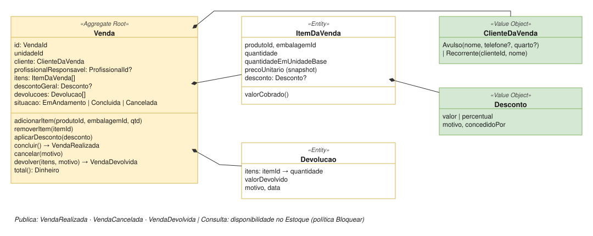

# Vendas

| | |
|---|---|
| **Classificação** | 🟡 Supporting |
| **Subdomínio** | Venda de Produtos |
| **Situação** | ✅ Modelagem tática definida (com premissa a confirmar: V1) |

## Propósito

Registrar a venda de produtos aos clientes e publicar o fato para Cobrança, Remuneração, Estoque e, nas unidades com parceiro, Liquidação.

## Modelo



## 1. Comandos e eventos

| Comando | Ator | Evento |
|---|---|---|
| Iniciar Venda | Recepcionista ou profissional | — |
| Adicionar / Remover Item | Recepcionista ou profissional | — |
| Aplicar Desconto | Quem tiver a permissão (role) | — |
| Concluir Venda | Recepcionista ou profissional | VendaRealizada |
| Cancelar Venda (antes de concluir) | Recepcionista | VendaCancelada |
| Registrar Devolução | Role autorizada | VendaDevolvida |

## 2. Invariantes

- Uma venda só é concluída com **pelo menos um item**.
- Quantidades são **maiores que zero**; o valor cobrado de cada item e o total **nunca são negativos**.
- O **preço de cada item é congelado** quando o item é adicionado ([ADR-008](../adr/008-snapshot-das-regras-no-momento-do-fato.md)).
- Só produtos marcados como **vendáveis** no Catálogo entram numa venda.
- Uma venda **concluída não muda**. Correções são feitas por **devolução** ([ADR-034](../adr/034-devolucao-como-evento-compensatorio.md)).
- A quantidade devolvida de um item **nunca passa da quantidade vendida**, somando todas as devoluções.
- Com a política de depósito `Bloquear`, a venda só é concluída se houver saldo ([ADR-029](../adr/029-politica-de-venda-sem-saldo-por-deposito.md)).

## 3. Agregado

```
Venda (Aggregate Root)
  id, unidadeId
  cliente: ClienteDaVenda                    Avulso(nome, telefone?, quarto?) | Recorrente(clienteId, nome)
  profissionalResponsavel: ProfissionalId?   opcional: base da comissão de produtos
  itens: ItemDaVenda[]
  descontoGeral: Desconto?
  devolucoes: Devolucao[]
  situacao: EmAndamento | Concluida | Cancelada

  adicionarItem(produtoId, embalagemId, quantidade)    preço de tabela da unidade, congelado
  removerItem(itemId)
  aplicarDesconto(desconto)                            no item ou na venda
  concluir()                                           → VendaRealizada
  cancelar(motivo)                                     só EmAndamento → VendaCancelada
  devolver(itens, motivo)                              só Concluida → VendaDevolvida
  total(): Dinheiro

ItemDaVenda (Entity)
  produtoId, embalagemId, quantidade
  quantidadeEmUnidadeBase                    ex.: 1 frasco = 1.000 ml
  precoUnitario (snapshot), desconto?
  valorCobrado()

Devolucao (Entity)
  itens: itemId → quantidade, valorDevolvido, motivo, data
```

O desconto geral é **distribuído entre os itens** na proporção do valor de cada um, para que cada consumidor (comissão, participação do parceiro, custo) receba o valor por item.

## 4. Eventos publicados

```
VendaRealizada
  vendaId, unidadeId, profissionalId?, cliente, data,
  itens: (produtoId, quantidadeEmUnidadeBase, precoDeTabela, valorCobrado),
  valorTotal

VendaCancelada     vendaId                      (nada foi publicado antes; sem efeito nos demais)

VendaDevolvida
  vendaId, devolucaoId, unidadeId, profissionalId?,
  itens: (produtoId, quantidadeEmUnidadeBase, valorDevolvido), data
```

| Consumidor | VendaRealizada | VendaDevolvida |
|---|---|---|
| Cobrança | Cria a cobrança | Estorna o valor (total ou parcial) |
| Remuneração | Comissão de produto, se houver responsável | Linha negativa de comissão |
| Estoque | Saída por venda | Entrada de retorno ao depósito (ou perda, se o produto não puder voltar) |
| Liquidação | Via `VendaCobrada`, nas unidades com acordo | Via estorno da cobrança |

## 5. Repositórios e serviços de aplicação

```
Repositórios
  VendaRepository                porId(id)

Serviços de aplicação
  IniciarVenda / AdicionarItem / RemoverItem
  AplicarDesconto                verifica role → aplica
  ConcluirVenda                  política Bloquear: consulta disponibilidade no Estoque → conclui
  CancelarVenda
  RegistrarDevolucao             verifica role → devolve
```

## 6. Testes de domínio

- Concluir venda sem itens gera erro.
- Adicionar produto não vendável gera erro.
- Alterar o preço no Catálogo depois de adicionar o item não muda o preço do item.
- Venda de 2 frascos a R$ 100 com desconto geral de R$ 20 → total de **R$ 180**, R$ 90 por item.
- Desconto maior que o valor gera erro.
- Cancelar uma venda concluída gera erro (deve ser devolução).
- Devolver 3 unidades de um item vendido com 2 gera erro; devolver 1 e depois mais 1 é permitido.
- Venda com política `Bloquear` e saldo insuficiente não é concluída.

## Pendências

V1 em [Pendências](../05-pendencias.md).
