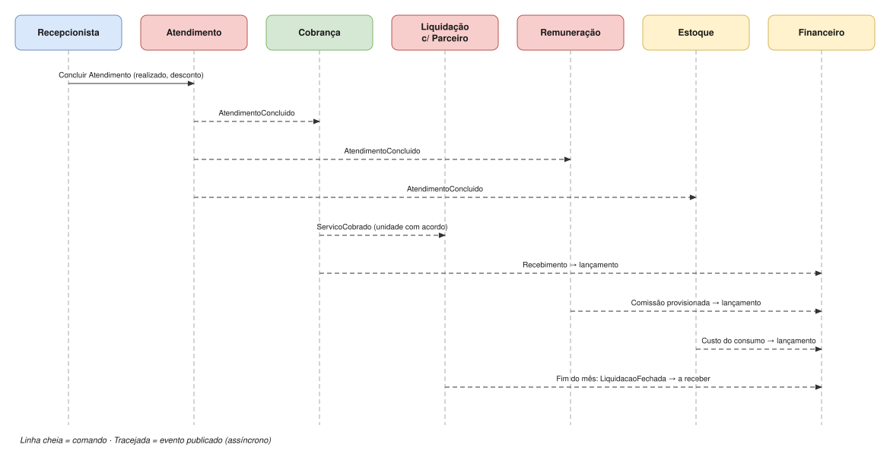

# Fluxo: atendimento concluído

Como um único fato, *Atendimento Concluído*, se propaga pelos contextos. Cada contexto reage por conta própria aos eventos que lhe interessam; o Atendimento não sabe quem consome.

| # | De → Para | Mensagem | Tipo |
|---|---|---|---|
| 1 | Recepcionista → Atendimento | Concluir Atendimento (itens realizados, desconto) | Comando |
| 2 | Atendimento → Cobrança | AtendimentoConcluido (uma cobrança pelo total dos itens) | Evento |
| 3 | Atendimento → Remuneração | AtendimentoConcluido (uma comissão por item com profissional) | Evento |
| 4 | Atendimento → Estoque | AtendimentoConcluido (ficha técnica de cada item) | Evento |
| 5 | Cobrança → Liquidação | ServicoCobrado (só unidades com acordo) | Evento |
| 6 | Cobrança → Financeiro | Recebimento → lançamento | Evento |
| 7 | Remuneração → Financeiro | Comissão provisionada → lançamento | Evento |
| 8 | Estoque → Financeiro | Custo do consumo → lançamento | Evento |
| 9 | Liquidação → Financeiro | No fim do período do acordo (semana, quinzena ou mês): LiquidacaoFechada → valor a receber | Evento |

**Consistência:** só o passo 1 é uma transação síncrona. Os demais são **eventualmente consistentes**: cada consumidor processa no seu tempo e de forma idempotente (o mesmo evento recebido duas vezes não duplica efeitos).
